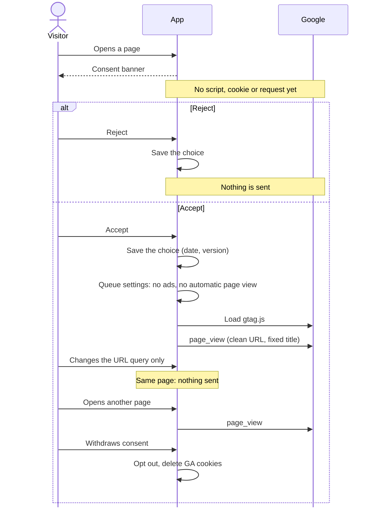
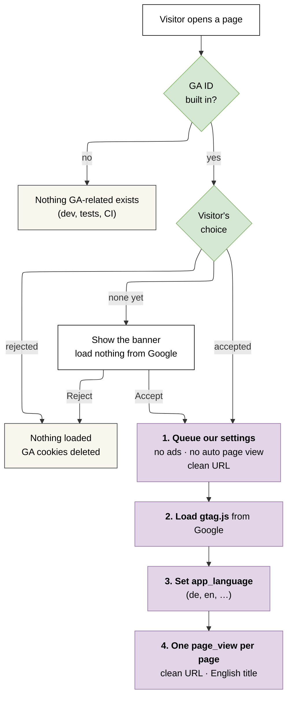

# Google Analytics

How Climatica uses Google Analytics (GA4): only after the visitor accepts, with nothing that locates
them. The configuration details are in [operations.md](operations.md#google-analytics-id), the
consent mechanics in [settings.md](settings.md#analytics-consent).

## How it should work

The usual practice for analytics in an EU web app, and what Climatica follows:

- **Opt-in, before anything loads.** No Google script, cookie or request until the visitor accepts.
  Rejecting is as easy as accepting, and the choice can be changed at any time. Google's Consent
  Mode is the softer alternative: it loads GA in a denied state and sends cookieless pings.
  Climatica doesn't load GA at all until consent.
- **A recorded, expiring choice.** It is saved with its date and a version, and the banner asks
  again when it expires or when the policy changes.
- **Page views sent by the app.** In a single-page app GA's automatic page views fire on every URL
  change. They are turned off, and the app sends one `page_view` per real page.
- **Only what's needed.** No personal or location data, so no query string or hash. No ads or Google
  Signals, and data retention as short as the reports allow.
- **Stable values.** Titles and dimensions are fixed English constants, so reports don't split by
  interface language. The language is its own dimension.
- **Production only.** One ID for the live site. Dev, tests and CI send nothing, and internal
  traffic is filtered out.

## The big picture

## A typical visit

1. **First visit.** The banner appears at the bottom. Google hasn't been contacted at all yet.
2. **Accept.** The choice is saved in the browser with a date and a version number. GA loads, and
   one `page_view` goes out:
   - Page: `https://climatica.gsic.uva.es/climate-statistics`. The URL actually reads
     `…?city=Paris&lat=48.85&lng=2.35`, but only the origin and path are sent.
   - Title: "City Climate", always in English.
   - `app_language`: `de` if the interface is in German.
3. **Changing filters, the chart type, or using "Use my location".** These only change the query
   string, so nothing is sent: the path is the same.
4. **Going to About.** One new `page_view` for `/about`, with `/climate-statistics` as the previous
   page.
5. **Switching the language to Ukrainian.** `app_language` becomes `uk`, and the next hit carries
   it.
6. **Changing your mind** (Settings → Analytics off, or "Cookie settings" → Reject). GA's own
   opt-out switch stops sending at once, and its cookies are deleted. On later visits nothing is
   loaded.
7. **After 12 months, or if we raise the consent version,** the banner asks again.

## Where each part lives

| What                                              | File                                                                                                                                                              |
| ------------------------------------------------- | ----------------------------------------------------------------------------------------------------------------------------------------------------------------- |
| GA ID: empty or `G-…`, fixed at build time        | [`src/libs/Env.ts`](../src/libs/Env.ts), [`.env.production`](../.env.production)                                                                                  |
| Banner, GA loading, reject/withdraw               | [`src/components/consent/`](../src/components/consent)                                                                                                            |
| The saved choice, its version and 12-month expiry | [`useAnalyticsConsent`](../src/hooks/persisted/useAnalyticsConsent.ts), [`analyticsConsentStore`](../src/stores/analyticsConsentStore.ts)                         |
| Clean URL, English titles, the GA commands        | [`analyticsConsent.util.ts`](../src/utils/analyticsConsent.util.ts), [`analytics.constant.ts`](../src/constants/analytics.constant.ts)                            |
| One page view per page, never twice in a row      | [`useGaPageViews`](../src/hooks/ui/useGaPageViews.ts), [`gaPageViewTracker`](../src/stores/gaPageViewTracker.ts)                                                  |
| Interface language                                | [`useGaAppLanguage`](../src/hooks/ui/useGaAppLanguage.ts)                                                                                                         |
| Settings switch and Cookie settings               | [`PrivacySettings`](../src/app/settings/_components/components/PrivacySettings.tsx), [`CookieSettingsButton`](../src/components/consent/CookieSettingsButton.tsx) |

## The privacy rules, in short

- **Nothing before consent:** before Accept there's no Google script and no request to Google.
- **No location data:** no query string or hash is ever sent, so no coordinates, places or regions.
- **No translated text:** only English constants go to Google, plus the language code itself.
- **No ads or Google Signals:** turned off in code, and they should stay off in the GA property too.

## What the GA property itself needs

- Turn off "Page changes based on browser history events". Otherwise GA counts every filter change
  as a page view, because the app rewrites its URL.
- Register `app_language` as a custom dimension with user scope, or it won't show up in reports.
- Set data retention to the shortest period the reports need.
- Add an internal traffic filter for the team's own visits.

## Tests

- **Default run and CI** (`analytics.e2e.ts`, `analyticsOff.e2e.ts`): every Google request is
  answered by the test itself, so nothing leaves the machine.
- **Opt-in** (`npm run test:e2e:analytics`): loads the real gtag.js and checks the hits it would
  send. Run it before a release. See [testing.md](testing.md).
