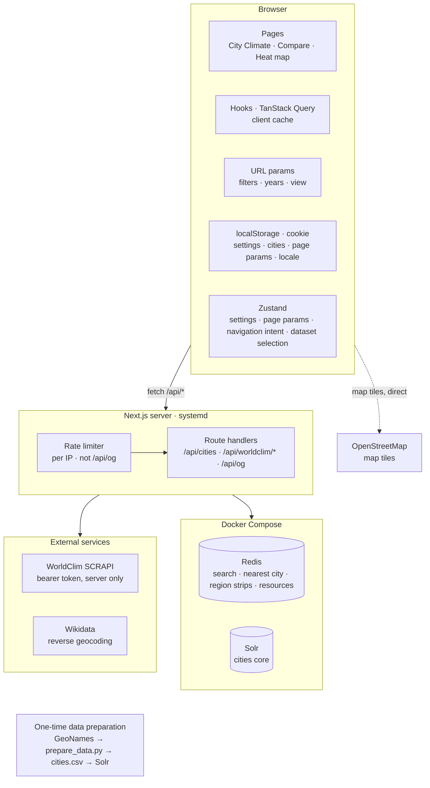
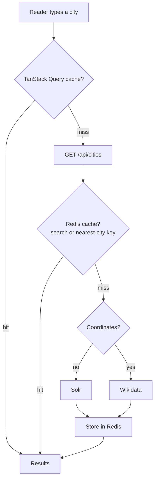
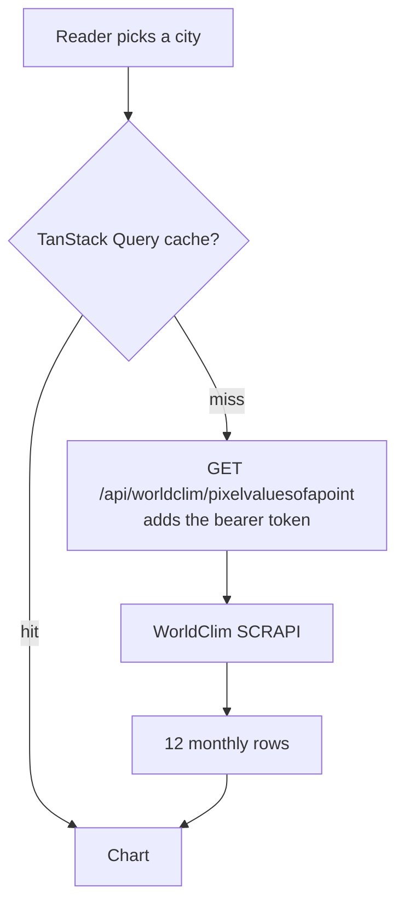

# Architecture

Where code lives, how data reaches a component, and where state is kept. Pages are in
[pages.md](pages.md), charts in [charts.md](charts.md).

## Overview

The browser keeps filters and view state in the URL; settings, cities and the navbar's last page
params in localStorage; the locale in a cookie ([State](#state)). Every API route but `/api/og`
starts with a per-IP rate limiter; a route handler answers from Redis or asks Solr, Wikidata or
WorldClim. Map tiles (on screen and in the heat map export) come straight from OpenStreetMap. The Next.js app runs under systemd; Redis and Solr run in Docker Compose
([operations.md](operations.md)).

## Folder structure

| Path                                                       | What lives there                                                                                                            |
| ---------------------------------------------------------- | --------------------------------------------------------------------------------------------------------------------------- |
| [`src/app/`](../src/app)                                   | routes without a locale prefix; each `page.tsx` renders its container in `Suspense`; `/` redirects to `/climate-statistics` |
| `src/app/<page>/_components/`                              | a page's container, view and their type / constant / util files                                                             |
| [`src/app/api/`](../src/app/api)                           | route handlers: `cities`, `worldclim/[queryId]`, `worldclim/resource`, `og` ([backend.md](backend.md))                      |
| [`src/layouts/`](../src/layouts)                           | the shell: [`AppLayout`](../src/layouts/AppLayout.tsx) (topbar, filters sidebar, main) and its host components (`UrlSync`)  |
| [`src/components/`](../src/components)                     | shared primitives in `UI/`, features in their own folder (`charts/`, `filters/`, `page/`), other shared components          |
| [`src/hooks/`](../src/hooks)                               | `data/` (queries), `filters/`, `url/`, `ui/`, `persisted/`, `charts/`, `pages/` (page hooks)                                |
| [`src/libs/`](../src/libs)                                 | `api/` (`apiClient`), `services/` (WorldClim, Solr, Wikidata), `redis/`, `Env.ts`, i18n setup                               |
| [`src/stores/`](../src/stores)                             | Zustand stores and the persisted location stores                                                                            |
| `src/constants/`, `src/enums/`, `src/types/`, `src/utils/` | shared constants, enums, types, pure functions                                                                              |
| [`src/i18n/locales/`](../src/i18n/locales)                 | one message file per locale                                                                                                 |
| [`src/styles/`](../src/styles)                             | global CSS by concern; every colour in `tokens.css` ([colors.md](colors.md))                                                |
| [`docker/`](../docker), [`tests/`](../tests)               | Solr and Redis ([operations.md](operations.md)); Vitest and Playwright ([testing.md](testing.md))                           |

## Data flow

- **Components never call the network**; queries live in [`src/hooks/data/`](../src/hooks/data)
  (TanStack Query; WorldClim data with `staleTime: Infinity`, since a period's values never change;
  city searches with 30 s).
- **Hooks reach external data only through `/api` routes** via
  [`apiClient`](../src/libs/api/apiClient.ts) (same origin, 50 s timeout).
  [`WorldClimService`](../src/libs/services/worldClimService.ts) builds WorldClim queries and
  validates responses.
- **The server keeps secrets and cache:** route handlers add the API key, rate-limit and cache in
  Redis; Solr and Wikidata services are `server-only`.
- **A city search and its climate data are two separate requests**, each cached by TanStack Query
  in the browser. On the server Redis caches the search, but not a city's climate data: of
  WorldClim's answers it keeps only region strips and resource lookups
  ([backend.md](backend.md#redis-caching)).

### City search

[`SearchBar`](../src/components/SearchBar/SearchBar.tsx) asks
[`useSearchCity`](../src/hooks/data/useSearchCity.ts) 400 ms after the last keystroke, from two
characters (the route also answers `[]` below two). Text like `40.41, -3.70` is reverse-geocoded by
Wikidata and cached under `nearest-city:`; anything else goes to Solr under `city-search:`. Only
non-empty results are stored. How Solr ranks the results is in [city-search.md](city-search.md).

### Climate data

1. **Pick:** [`useCitySelection`](../src/hooks/pages/useCitySelection.ts) writes the persisted city
   (and, with `syncCity`, the slots that follow it); the page hook pushes it to the URL.
2. **Fetch:** the data hook's key changes and the query goes through `WorldClimService`. A point's
   Climate answer holds every normals period, so a period change needs no request.
3. **Shape:** twelve monthly rows, missing values `null` ([climate-indices.md](climate-indices.md)).
4. **Model and draw:** the page hook builds a `TChartSeries`, derives the chart model
   ([charts.md](charts.md)) and the view passes it to `ChartSection` ([pages.md](pages.md)).

The comparison pages run the same steps per series.

## State

| Kind                               | Where                                                                                                                          |
| ---------------------------------- | ------------------------------------------------------------------------------------------------------------------------------ |
| Server data                        | TanStack Query                                                                                                                 |
| Filters and page view state        | the URL ([url-state.md](url-state.md))                                                                                         |
| Client state that isn't page state | Zustand: `settingsStore`, `lastPageParamsStore`, `navigationIntentStore`, `datasetSelectionStore` ([settings.md](settings.md)) |
| Persisted cities                   | [`persistedLocationStores`](../src/stores/persistedLocationStores.ts) (`useSyncExternalStore`, not Zustand)                    |
| UI only (open, hover, drafts)      | `useState`                                                                                                                     |

## Shared UI

- **Primitives** in [`src/components/UI/`](../src/components/UI); the catalog, one line per
  component, is in [AGENTS.md](../AGENTS.md). Search it before creating a component.
- **Surfaces:** every in-flow framed block is a [`Card`](../src/components/Card/Card.tsx) — a
  border, no shadow; only floating layers (popovers, menus, sheets) cast one.
- **Controls:** every outlined control takes its frame, height, hover and focus from
  [`FORM_CONTROL_CLASSES`](../src/constants/formControl.constant.ts); Leaflet's zoom buttons match
  in [`leaflet.css`](../src/styles/leaflet.css).
