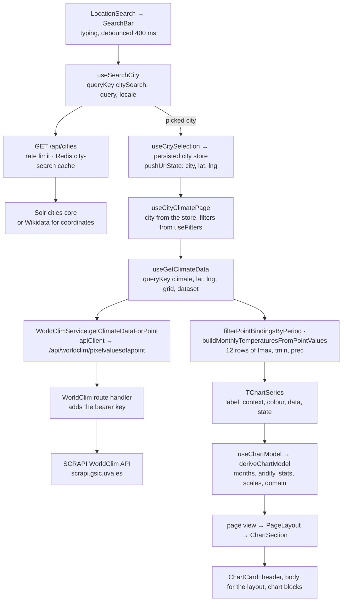

# Architecture

How the app is put together: where code lives, how data reaches a component, and how pages
are split. How a page is built is in [pages.md](pages.md); how its chart is built, in
[charts.md](charts.md).

## Folder structure

| Path                                                       | What lives there                                                                                                                                                                                                                |
| ---------------------------------------------------------- | ------------------------------------------------------------------------------------------------------------------------------------------------------------------------------------------------------------------------------- |
| [`src/app/`](../src/app)                                   | Next.js routes, without a locale prefix ([localization-i18n.md](localization-i18n.md)). Each `page.tsx` renders its page container inside `Suspense`. `/` redirects to `/climate-statistics`; `/settings` is the settings page. |
| `src/app/<page>/_components/`                              | A page's container, view and their type / constant / util files (e.g. [`climate-statistics/_components`](../src/app/climate-statistics/_components)).                                                                           |
| [`src/app/api/`](../src/app/api)                           | Route handlers: `cities`, `worldclim/[queryId]`, `worldclim/resource`, `og`. See [backend.md](backend.md).                                                                                                                      |
| [`src/app/providers.tsx`](../src/app/providers.tsx)        | TanStack Query client.                                                                                                                                                                                                          |
| [`src/layouts/`](../src/layouts)                           | The app shell: [`AppLayout`](../src/layouts/AppLayout.tsx) (topbar, the filters sidebar on filter pages, main, [`ThemeRoot`](../src/components/ThemeRoot/ThemeRoot.tsx)) and [`UrlSync`](../src/layouts/UrlSync.tsx).           |
| [`src/components/`](../src/components)                     | Components. Shared primitives in `UI/`, features in their own folder (`filters/`, `charts/`, `page/`), shared non-UI components (Card, ChartLegend…) in their own folders.                                                      |
| [`src/hooks/`](../src/hooks)                               | `data/` (queries), `filters/`, `url/`, `ui/`, `persisted/`, `charts/` (the chart model, its exports and chart hooks), `pages/` (each page's hook and the logic pages share).                                                    |
| [`src/libs/`](../src/libs)                                 | `api/` (axios `apiClient`), `services/` (WorldClim, Solr, Wikidata), `redis/` (client, strategies, rate limit), `Env.ts`, i18n setup.                                                                                           |
| [`src/stores/`](../src/stores)                             | Zustand stores and the persisted location stores.                                                                                                                                                                               |
| `src/constants/`, `src/enums/`, `src/types/`, `src/utils/` | Shared constants, enums, types and pure functions.                                                                                                                                                                              |
| [`src/i18n/locales/`](../src/i18n/locales)                 | Message files, one per locale. See [localization-i18n.md](localization-i18n.md).                                                                                                                                                |
| [`src/styles/`](../src/styles)                             | Global CSS, split by concern and imported by `global.css`; every colour value is in `tokens.css` (see [colors.md](colors.md)).                                                                                                  |
| [`docker/`](../docker)                                     | Solr and Redis for local development. See [operations.md](operations.md).                                                                                                                                                       |
| [`tests/`](../tests)                                       | `unit/` (Vitest) and `e2e/` (Playwright). See [testing.md](testing.md).                                                                                                                                                         |

## Data flow

```
Component → hook (src/hooks/) → apiClient (src/libs/api/)
          [→ client service, e.g. WorldClimService]
          → /api route handler (src/app/api/)
          → Redis cache → Solr / WorldClim / Wikidata
```

- **Components never call the network.** They use hooks; queries live in
  [`src/hooks/data/`](../src/hooks/data) and use TanStack Query (WorldClim data with
  `staleTime: Infinity`, since a period's values never change).
- **Hooks reach external data only through `/api` routes**, with the shared axios instance
  [`apiClient`](../src/libs/api/apiClient.ts) (same-origin base URL, 50 s timeout). City
  lookups call `/api/cities` directly from the hook
  ([`useSearchCity`](../src/hooks/data/useSearchCity.ts)); WorldClim calls go through
  [`WorldClimService`](../src/libs/services/worldClimService.ts), which builds the query
  parameters and validates responses.
- **The server keeps the secrets and the cache.** Route handlers add the WorldClim API key,
  rate-limit per IP and cache in Redis; Solr and Wikidata are reached only from the server
  ([`solrService`](../src/libs/services/solrService.ts) and
  [`wikidataService`](../src/libs/services/wikidataService.ts) import `server-only`).

### End to end: from a city search to the chart

What happens between typing a city and seeing its chart, on City Climate (the comparison pages
run the same steps per series):



1. **Search.** [`LocationSearch`](../src/components/LocationSearch/LocationSearch.tsx)'s
   [`SearchBar`](../src/components/SearchBar/SearchBar.tsx) asks
   [`useSearchCity`](../src/hooks/data/useSearchCity.ts) 400 ms after the last keystroke,
   from two characters on;
   [`/api/cities`](../src/app/api/cities/route.ts) answers from Redis or Solr, or reverse-geocodes
   coordinates with Wikidata ([backend.md](backend.md)).
2. **Pick.** [`useCitySelection`](../src/hooks/pages/useCitySelection.ts) writes the persisted
   city and, with sync city on, the slots that follow it (refetching their pages' queries); the
   page hook pushes it to the URL ([url-state.md](url-state.md)).
3. **Fetch.** The data hook's key changes, so TanStack Query fetches through
   `WorldClimService` and the proxy route, which adds the API key and forwards the query to
   SCRAPI's WorldClim API. A point's Climate answer holds every normals period at once, so a
   period change is filtered from the cached answer without a request.
4. **Shape.** The bindings become twelve monthly rows; missing values stay `null`
   ([climate-indices.md](climate-indices.md)).
5. **Model.** The page hook wraps the rows in a `TChartSeries` and derives the chart model
   ([charts.md](charts.md)).
6. **Draw.** The view passes the hook's result to `ChartSection`, which draws the export menu,
   the stats table and the chart card ([pages.md](pages.md)).

## Pages

Every page is a one-line container and a short view: the container calls the page's hook in
[`src/hooks/pages/`](../src/hooks/pages) and passes the result to the view, which fills the
shared [`PageLayout`](../src/components/page/PageLayout.tsx) (header, controls, the results'
status, then summary, main content and details). Every difference between pages lives in the
hook; the chart pages' main content is the shared
[`ChartSection`](../src/components/charts/ChartSection.tsx), drawn from a list of series and
the model derived from them.

- [pages.md](pages.md): the three layers, the four pages, `PageLayout` and its spacing, data
  states and errors, the shared page hooks, and how to add a block on every page or a new
  chart page.
- [charts.md](charts.md): series and kind rules, the model, view state and features, the chart
  section, card and bodies, the chart block registry (and how to add a block under every
  chart), exports and data updates.
- [colors.md](colors.md): the colour layers (primitives, semantic tokens, components), series
  colours, colours in exports, the allowlist and how to add a colour.
- [climate-indices.md](climate-indices.md): the Walter-Lieth diagram's geometry and rules, and
  the derived values (arid and frost months, the De Martonne index).
- [export.md](export.md): CSV, PNG, SVG and raw exports, and the heat map image.
- [heat-map.md](heat-map.md): the heat map page, its region, requests and colour scales.

Filters and page view state live in the URL, not in component state. See
[url-state.md](url-state.md).

## State

| Kind                                                          | Where                                                                                                                                                                                                                                                           |
| ------------------------------------------------------------- | --------------------------------------------------------------------------------------------------------------------------------------------------------------------------------------------------------------------------------------------------------------- |
| Server data                                                   | TanStack Query                                                                                                                                                                                                                                                  |
| Filters and page view state (chart mode, layout, years, city) | URL search params                                                                                                                                                                                                                                               |
| Client-only, not page state                                   | Zustand: [`settingsStore`](../src/stores/settingsStore.ts) (persisted preferences), [`lastPageParamsStore`](../src/stores/lastPageParamsStore.ts) (navbar cache), [`navigationIntentStore`](../src/stores/navigationIntentStore.ts) (in-flight link navigation) |
| Persisted cities                                              | [`persistedLocationStores`](../src/stores/persistedLocationStores.ts) (small `useSyncExternalStore` stores, not Zustand)                                                                                                                                        |
| UI-only (open, hover, drafts)                                 | `useState`                                                                                                                                                                                                                                                      |

## Settings

The reader's preferences are one persisted Zustand store,
[`settingsStore`](../src/stores/settingsStore.ts), under the single localStorage key
`climatica:settings`; the language is the `NEXT_LOCALE` cookie. The store, its migration, the
theme, the animations, the settings page and what is kept in the URL, localStorage and the
cookie are in [settings.md](settings.md).

## Where shared UI lives

- **Primitives** in [`src/components/UI/`](../src/components/UI): Badge, Button, Chip, Dropdown,
  BottomSheet, StatusMessage, StatCell, PairLayout, ChipScroller, skeletons and others.
- **Shared components outside UI** in their own folders: Card, ChartLegend, PageHeader,
  SegmentedControl, ScrollEdgeFades, SeriesMarker, ThemeRoot.
- **Features** in one folder each, flat: `charts/` (the chart section, card, bodies, blocks),
  `page/` (`PageLayout`), `filters/`.
- The full list, one line per component with its purpose, is the "Shared UI components"
  catalog in [AGENTS.md](../AGENTS.md); each component's props are in its `.type.ts`. Search the
  catalog before creating a component.
- **Surfaces and controls:** every in-flow framed block (tables, stat cards, the heat map and
  the mini map) is a Card — a border, no shadow; only floating layers (popovers, dropdowns,
  menus, sheets) cast one. Every outlined control — the search and year inputs, outline
  buttons, the export menu, the map toolbar — takes its frame, height, hover and focus from
  [`FORM_CONTROL_CLASSES`](../src/constants/formControl.constant.ts). Leaflet's zoom buttons are
  restyled to the same border in [`leaflet.css`](../src/styles/leaflet.css).
