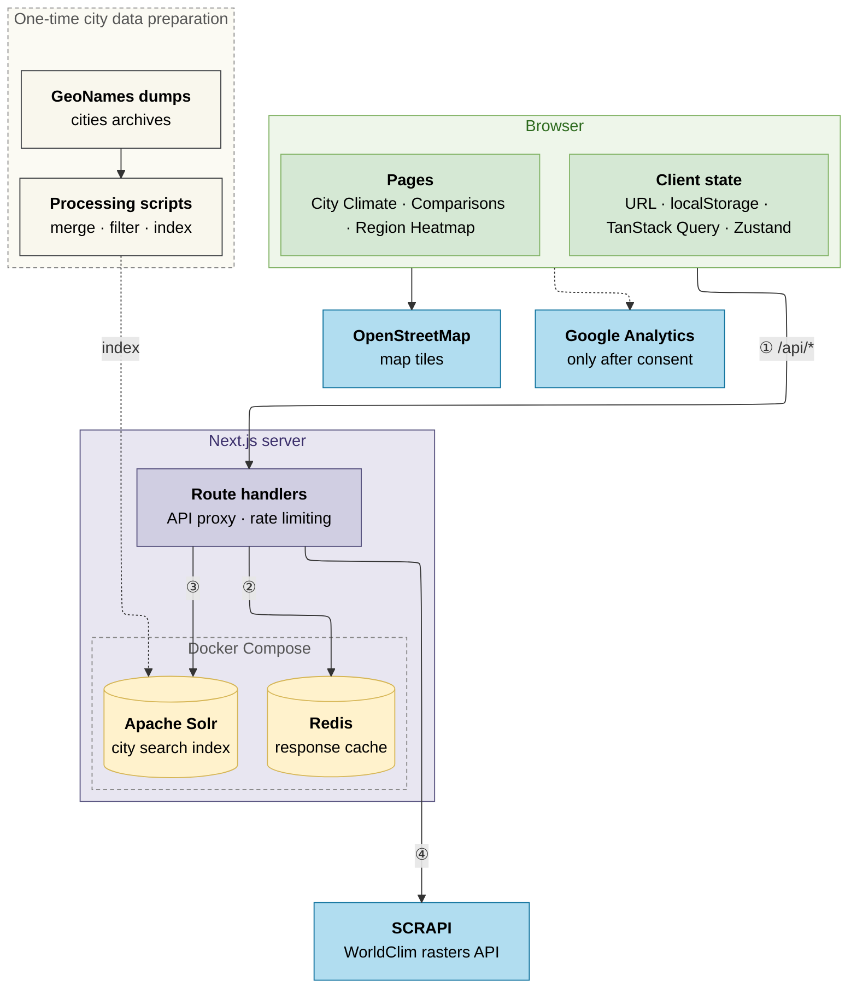
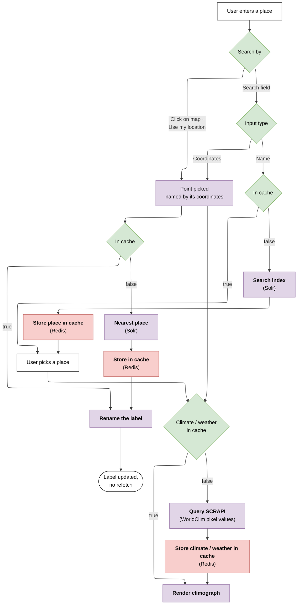

# Architecture

Where code lives, how data reaches a component, and where state is kept. Pages are in
[pages.md](pages.md), charts in [charts.md](charts.md).

## Overview

The browser keeps filters and view state in the URL; settings, cities, the analytics choice and
the navbar's last page params in localStorage; the locale in a cookie ([State](#state)). It talks
to the server only through `/api/*` (①). Every API route but `/api/og` starts with a per-IP rate
limiter; a route handler answers from Redis (②), or asks Solr for places (③) or SCRAPI for
WorldClim values (④) and caches the answer. Map tiles, on screen and in the heat map export, come
straight from OpenStreetMap. Google Analytics loads only after the reader accepts it
([operations.md](operations.md)). The Solr index is built once from GeoNames dumps
([city-search.md](city-search.md)). The Next.js app runs under systemd; Redis and Solr run in
Docker Compose ([operations.md](operations.md)).

## Folder structure

| Path                                                       | What lives there                                                                                                            |
| ---------------------------------------------------------- | --------------------------------------------------------------------------------------------------------------------------- |
| [`src/app/`](../src/app)                                   | routes without a locale prefix; each `page.tsx` renders its container in `Suspense`; `/` redirects to `/climate-statistics` |
| `src/app/<page>/_components/`                              | a page's container, view and their type / constant / util files                                                             |
| [`src/app/about/`](../src/app/about)                       | the Info pages (About, User guide, Data & methods) and their shared layout ([pages.md](pages.md#info-pages))                |
| [`src/app/api/`](../src/app/api)                           | route handlers: `cities`, `worldclim/[queryId]`, `worldclim/resource`, `og` ([backend.md](backend.md))                      |
| [`src/layouts/`](../src/layouts)                           | the shell: [`AppLayout`](../src/layouts/AppLayout.tsx) (topbar, filters sidebar, main) and its host components (`UrlSync`)  |
| [`src/components/`](../src/components)                     | shared primitives in `UI/`, features in their own folder (`charts/`, `filters/`, `page/`, `info/`), other shared components |
| [`src/hooks/`](../src/hooks)                               | `data/` (queries), `filters/`, `url/`, `ui/`, `persisted/`, `charts/`, `pages/` (page hooks)                                |
| [`src/libs/`](../src/libs)                                 | `api/` (`apiClient`), `services/` (WorldClim, Solr), `redis/`, `Env.ts`, i18n setup                                         |
| [`src/stores/`](../src/stores)                             | Zustand stores and the persisted location stores                                                                            |
| `src/constants/`, `src/enums/`, `src/types/`, `src/utils/` | shared constants, enums, types, pure functions                                                                              |
| [`src/i18n/locales/`](../src/i18n/locales)                 | one message file per locale                                                                                                 |
| [`src/styles/`](../src/styles)                             | global CSS by concern; every colour in `tokens.css` ([colors.md](colors.md))                                                |
| [`docker/`](../docker), [`tests/`](../tests)               | Solr and Redis ([operations.md](operations.md)); Vitest and Playwright ([testing.md](testing.md))                           |

## Data flow

Each "In cache" stands for two layers: TanStack Query in the browser, then Redis on the server.

- **Components never call the network**; queries live in [`src/hooks/data/`](../src/hooks/data)
  (TanStack Query; WorldClim data with `staleTime: Infinity`, since a period's values never change;
  city searches with 30 s).
- **Hooks reach external data only through `/api` routes** via
  [`apiClient`](../src/libs/api/apiClient.ts) (same origin, 50 s timeout).
  [`WorldClimService`](../src/libs/services/worldClimService.ts) builds WorldClim queries and
  validates responses.
- **The server keeps secrets and cache:** route handlers add the API key, rate-limit and cache in
  Redis; the Solr service is `server-only`.
- **A place and its climate data are separate requests**, each cached in the browser and on the
  server: the search by its text, a point's climate data by the raster cell holding the point
  ([backend.md](backend.md#redis-caching)).

### Search field: a name

[`SearchBar`](../src/components/SearchBar/SearchBar.tsx) asks
[`useSearchCity`](../src/hooks/data/useSearchCity.ts) 400 ms after the last keystroke, from two
characters (the route also answers `[]` below two). `GET /api/cities?q=&lang=` answers from Redis
(`city-search:<lang>:<query>`) or asks Solr's search index and stores any non-empty answer. The
user picks a place, and its climate data is fetched at the city's own coordinates. How Solr ranks
results is in [city-search.md](city-search.md).

### Coordinates, a map click or "Use my location": a point

Text like `40.41, -3.70` is never searched: the bar offers "Go to coordinates" at once. Picking
it, clicking the map ([`useMapPointSelection`](../src/hooks/pages/useMapPointSelection.ts)) or
locating the reader ([`useGeolocation`](../src/hooks/ui/useGeolocation.ts)) picks that exact
point straight away, named by its coordinates, and its climate data is fetched for that point.

In parallel, [`usePlaceLookup`](../src/hooks/data/usePlaceLookup.ts) asks `/api/cities` for the
nearest place: Redis (`nearest-city:<lang>:<lat>:<lng>`) or Solr's nearest populated place within
10 km, stored unless empty. The label is then renamed, keeping the coordinates, so the climate
queries don't change and nothing is refetched. A rename only applies while the slot still holds
that pick ([`renameIfStillPicked`](../src/utils/persistedJsonStore.util.ts)), and only the latest
lookup of a picker answers. A failed map lookup says so; typed coordinates and the reader's
position keep their coordinates quietly.

### Climate and weather data

1. **Pick:** [`useCitySelection`](../src/hooks/pages/useCitySelection.ts) writes the persisted city
   (and, with `syncCity`, the slots that follow it); the page hook pushes it to the URL.
2. **In cache:** the data hook's key changes; TanStack Query answers from the browser cache, or
   `GET /api/worldclim/pixelvaluesofapoint` answers from Redis, keyed by the point's raster cell, so
   every point in one cell shares the entry ([backend.md](backend.md#point-queries-by-cell)). A
   point's Climate answer holds every normals period, so a period change needs no request.
3. **Query SCRAPI:** on a miss, or near a cell edge, the route asks SCRAPI with the bearer token
   through `WorldClimService` and stores the answer.
4. **Shape:** twelve monthly rows, missing values `null` ([climate-indices.md](climate-indices.md)).
5. **Render:** the page hook builds a `TChartSeries`, derives the chart model
   ([charts.md](charts.md)) and the view passes it to `ChartSection` ([pages.md](pages.md)).

The comparison pages run the same steps per series.

## State

| Kind                               | Where                                                                                                                                                                          |
| ---------------------------------- | ------------------------------------------------------------------------------------------------------------------------------------------------------------------------------ |
| Server data                        | TanStack Query                                                                                                                                                                 |
| Filters and page view state        | the URL ([url-state.md](url-state.md))                                                                                                                                         |
| Client state that isn't page state | Zustand: `settingsStore`, `lastPageParamsStore`, `navigationIntentStore`, `datasetSelectionStore`, `consentBannerStore` ([settings.md](settings.md))                           |
| Persisted cities, analytics choice | [`persistedLocationStores`](../src/stores/persistedLocationStores.ts), [`analyticsConsentStore`](../src/stores/analyticsConsentStore.ts) (`useSyncExternalStore`, not Zustand) |
| UI only (open, hover, drafts)      | `useState`                                                                                                                                                                     |

## Shared UI

- **Primitives** in [`src/components/UI/`](../src/components/UI); the catalog, one line per
  component, is in [AGENTS.md](../AGENTS.md). Search it before creating a component.
- **Surfaces:** every in-flow framed block is a [`Card`](../src/components/Card/Card.tsx) — a
  border, no shadow; only floating layers (popovers, menus, sheets) cast one.
- **Controls:** every outlined control takes its frame, height, hover and focus from
  [`FORM_CONTROL_CLASSES`](../src/constants/formControl.constant.ts); Leaflet's zoom buttons match
  in [`leaflet.css`](../src/styles/leaflet.css).
