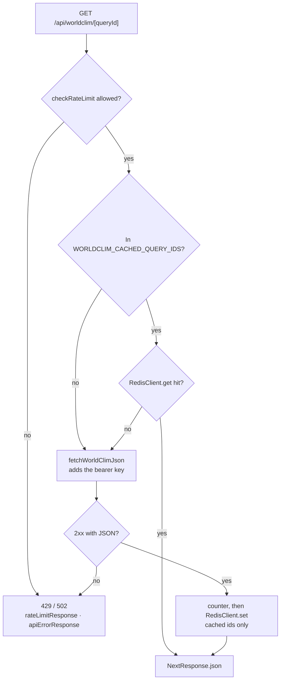

# Backend

Next.js route handlers in [`src/app/api/`](../src/app/api): they keep the WorldClim key on the
server, rate-limit, cache in Redis, and reach Solr, WorldClim and Wikidata. The browser only calls
these routes ([architecture.md](architecture.md#data-flow)).

## Route handlers

| Route                                                                           | Does                                                                                            | Cache                              |
| ------------------------------------------------------------------------------- | ----------------------------------------------------------------------------------------------- | ---------------------------------- |
| [`GET /api/cities?q=&lang=`](../src/app/api/cities/route.ts)                    | city search ([city-search.md](city-search.md)); under 2 characters `[]`; coordinates → Wikidata | Redis                              |
| [`GET /api/worldclim/[queryId]?…`](../src/app/api/worldclim/[queryId]/route.ts) | proxies a WorldClim query to SCRAPI, adding the bearer key                                      | region queries in Redis, per strip |
| [`GET /api/worldclim/resource?…`](../src/app/api/worldclim/resource/route.ts)   | proxies a resource lookup                                                                       | Redis, by query string             |
| [`GET /api/og?…`](../src/app/api/og/route.tsx)                                  | the Open Graph image for a shared link ([`resolveOgMeta`](../src/utils/metadata.util.ts))       | —                                  |

## A WorldClim request

Only region queries are in `WORLDCLIM_CACHED_QUERY_IDS` (`pixelvaluesinbox`,
`avgpixelvaluesinbox`, `avgpixelvaluesinpolygonGEO`); point queries go upstream every time and are
cached only in the browser. `/api/worldclim/resource` follows the same path, always cached;
`/api/cities` is in [architecture.md](architecture.md#city-search).

## Rate limiting

Every route but `/api/og` starts with [`checkRateLimit`](../src/libs/redis/rateLimit.ts): 1000
requests a minute per IP and endpoint; over it, `429` with `Retry-After`. If Redis is down the
limiter lets requests through rather than block the app.

## Redis caching

[`RedisClient`](../src/libs/redis/client.ts) connects lazily and retries with capped backoff. Its
`get` and `set` never throw: an error is logged and treated as a miss, so the app works without
the cache. Strategies in [`strategies.ts`](../src/libs/redis/strategies.ts), keys and TTLs in
[`redis.constant.ts`](../src/constants/redis.constant.ts):

| What                              | Key                                              | TTL                                |
| --------------------------------- | ------------------------------------------------ | ---------------------------------- |
| City search, under 4 characters   | `city-search:<lang>:<query>`                     | 1 day                              |
| City search                       | same                                             | 7 days; 30 once looked up 10 times |
| Nearest city                      | `nearest-city:<lat>:<lng>`                       | 7 days                             |
| WorldClim resource / region strip | `worldclim-resource:…`, `worldclim-query:<id>:…` | 7 days; 30 once looked up 5 times  |

**Popular queries:** each miss that reaches upstream increments a counter (`…-counter:…`); at the
threshold the result is stored with the longer TTL. Only non-empty city results and successful
WorldClim answers are cached; failures are retried on the next request.

## WorldClim proxy

[`WorldClimService`](../src/libs/services/worldClimService.ts) calls `/api/worldclim/*`; the handler
forwards the query unchanged with `Authorization: Bearer <WORLDCLIM_API_KEY>`.
[`fetchWorldClimJson`](../src/app/api/@utils/fetchWorldClimJson.util.ts) accepts only a 2xx with
valid JSON; anything else is a `502`.

### Row limits and strips

Point queries (`cellofpoint`, `pixelvaluesofapoint`) have no row limit. Region queries
(`pixelvaluesinbox`, `pixelvaluesinpolygonGEO`, their `avg…` versions) stop at 100 rows without a
`limit` and at **10,000 rows whatever the `limit`** (`WORLDCLIM_MAX_ROWS`); `offset` can't page past
that because the queries have no `ORDER BY`.

So the heat map fetches its cells as latitude strips that each fit in 10,000 rows
([`splitRegionIntoStrips`](../src/utils/regionQuery.util.ts)), in parallel, and merges them:

- Inner strip edges are grid lines, half a cell from any centroid, so every cell is in exactly one
  strip and a region always asks for the same strips (and hits the same cache keys).
- A region too wide for one row of cells per strip is also split by longitude.
- A polygon is read from its box's strips, keeping cells whose centroid is inside — the same cells
  as WorldClim's polygon query, which can't be split.
- A Climate region query names the period's rasters; without them every normals period comes
  back, five times the rows.

The cell cap and the page side are in [heat-map.md](heat-map.md).

## Wikidata reverse geocoding

For a coordinate query, [`WikidataService`](../src/libs/services/wikidataService.ts) asks Wikidata's
geosearch for up to 5 items within 10 km and returns the nearest as a `TCity` — the nearest item
with coordinates, not necessarily a settlement.

## Error handling

An upstream failure gets an error status and `{ "error": "<message>" }`
([`apiErrorResponse`](../src/utils/apiErrorResponse.util.ts), [`API_ERRORS`](../src/constants/api/api.constant.ts)),
never data, never cached:

| Failure                                       | Route                       | Answer                                    |
| --------------------------------------------- | --------------------------- | ----------------------------------------- |
| Solr unreachable, non-2xx, or non-zero status | `/api/cities` (text)        | `503`                                     |
| Wikidata fails                                | `/api/cities` (coordinates) | `502`                                     |
| WorldClim non-2xx, network failure, non-JSON  | `/api/worldclim/*`          | `502`                                     |
| Redis errors                                  | all                         | logged; misses; writes and limits skipped |

In the browser these reach hooks as TanStack Query errors. Page data errors show as the page's
translated message ([`getErrorMessageKey`](../src/utils/apiError.util.ts), never the raw text); a
failed city search says so in its dropdown. Altitude, cell bounds, the dataset attribution and the
available periods fail silently.
