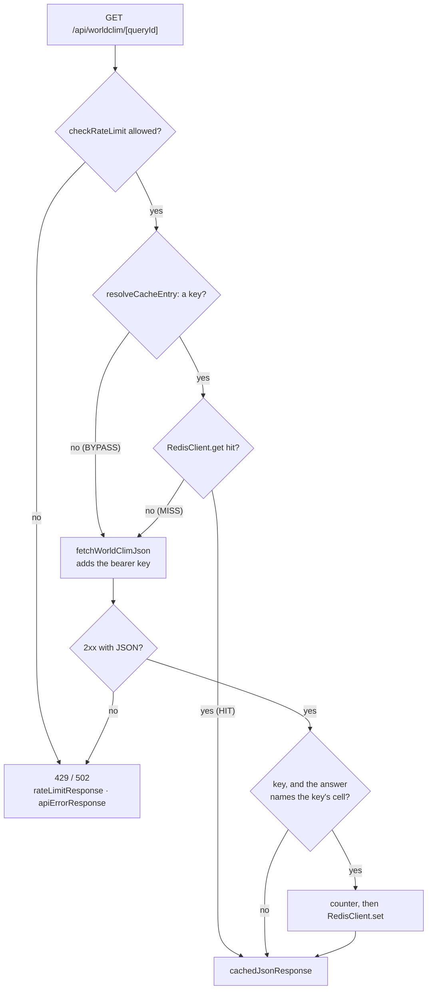

# Backend

Next.js route handlers in [`src/app/api/`](../src/app/api): they keep the WorldClim key on the
server, rate-limit, cache in Redis, and reach Solr and WorldClim. The browser only calls
these routes ([architecture.md](architecture.md#data-flow)).

## Route handlers

| Route                                                                           | Does                                                                                                 | Cache                                                    |
| ------------------------------------------------------------------------------- | ---------------------------------------------------------------------------------------------------- | -------------------------------------------------------- |
| [`GET /api/cities?q=&lang=`](../src/app/api/cities/route.ts)                    | city search ([city-search.md](city-search.md)); under 2 characters `[]`; coordinates → nearest place | Redis                                                    |
| [`GET /api/worldclim/[queryId]?…`](../src/app/api/worldclim/[queryId]/route.ts) | proxies a WorldClim query to SCRAPI, adding the bearer key                                           | point queries in Redis by cell; region queries per strip |
| [`GET /api/worldclim/resource?…`](../src/app/api/worldclim/resource/route.ts)   | proxies a resource lookup                                                                            | Redis, by query string                                   |
| [`GET /api/og?…`](../src/app/api/og/route.tsx)                                  | the Open Graph image for a shared link ([`resolveOgMeta`](../src/utils/metadata.util.ts))            | —                                                        |

## A WorldClim request

Region queries (`WORLDCLIM_CACHED_QUERY_IDS`: `pixelvaluesinbox`, `avgpixelvaluesinbox`,
`avgpixelvaluesinpolygonGEO`) are keyed by their query string. `/api/worldclim/resource` follows the
same path, always cached; `/api/cities` is in [architecture.md](architecture.md#city-search).

### Point queries, by cell

`pixelvaluesofapoint` and `cellofpoint` answer the same for every point in one raster cell (no
binding echoes the coordinates), so they're keyed by that cell, not by lat/lng
([`buildPointCacheParts`](../src/utils/pointCache.util.ts)):

- The cell is `row = floor((90 − lat) · n)`, `col = floor((lng + 180) · n)` with `n` cells per
  degree (`CELLS_PER_DEGREE`: 6, 12, 24, 120), counted from the north-west corner like SCRAPI's
  `Cell_<grid>_r<row>c<col>`.
- `pixelvaluesofapoint`: `worldclim-point:pixelvaluesofapoint:<grid>:r<row>c<col>:<sorted
variables>:climate` or `…:weather:<year>`. `cellofpoint` answers every grid at once and is keyed
  by the 30 s cell, which lies in one cell of each coarser grid.
- **Edges:** SCRAPI puts a point up to ~1e-4° from a cell edge in either cell, and not the same way
  at every grid. A point nearer an edge than `POINT_CELL_EDGE_MARGIN_DEG` (5e-4°, ~55 m) is
  fetched uncached (`BYPASS`), as is any request with an unexpected parameter.
- An answer is stored only when every binding names the key's cell
  ([`isAnswerForCells`](../src/utils/pointCache.util.ts)); an empty answer isn't stored.
- Size: about 130 KB of Redis memory for a climate answer (180 bindings: 3 variables × 12 months ×
  5 periods), 25 KB for a weather year, 1.4 KB for `cellofpoint`.

## Rate limiting

Every route but `/api/og` starts with [`checkRateLimit`](../src/libs/redis/rateLimit.ts): 1000
requests a minute per IP and endpoint; over it, `429` with `Retry-After`. If Redis is down the
limiter lets requests through rather than block the app.

## Redis caching

[`RedisClient`](../src/libs/redis/client.ts) connects lazily and retries with capped backoff. Its
`get` and `set` never throw: an error is logged and treated as a miss, so the app works without
the cache. Strategies in [`strategies.ts`](../src/libs/redis/strategies.ts), keys and TTLs in
[`redis.constant.ts`](../src/constants/redis.constant.ts):

| What                              | Key                                              | TTL                                          |
| --------------------------------- | ------------------------------------------------ | -------------------------------------------- |
| City search, under 4 characters   | `city-search:<lang>:<query>`                     | 1 day                                        |
| City search                       | same                                             | 7 days; 30 once looked up 10 times in 7 days |
| Nearest city                      | `nearest-city:<lang>:<lat>:<lng>`                | 7 days                                       |
| WorldClim resource / region strip | `worldclim-resource:…`, `worldclim-query:<id>:…` | 7 days; 30 once looked up 5 times in 7 days  |
| WorldClim point query             | `worldclim-point:<id>:<grid>:r<row>c<col>…`      | same                                         |

**Popular queries** ([`PopularityCache`](../src/libs/redis/popularity.ts)): every lookup of a key,
hit or stored miss, increments its counter (`…-counter:…`, living for the base TTL). The hit that
reaches the threshold extends the stored entry to the popular TTL in place (`EXPIRE`, no refetch);
a miss stores with the popular TTL once the key is popular. City searches under 4 characters keep
their short TTL and aren't counted. Only non-empty city results and successful WorldClim answers
are cached; failures are retried on the next request.

### Cache headers

Every successful data response of `/api/cities` and `/api/worldclim/*` goes through
[`cachedJsonResponse`](../src/utils/cachedJsonResponse.util.ts), which sets:

- `X-Cache`: `HIT` (answered from Redis), `MISS` (fetched upstream; stored unless empty, or for a
  point query unless it names another cell) or `BYPASS` (never cached: a city query under 2
  characters, a point near a cell edge or with unexpected params, any other WorldClim query id).
- `Server-Timing`, when the route called upstream: `solr` or `worldclim` with `dur`
  in ms, the upstream call alone ([`timeUpstream`](../src/utils/cachedJsonResponse.util.ts)),
  without Redis or the rate limiter.

Error and rate-limit responses carry neither. [`scripts/benchmark/`](../scripts/benchmark/README.md)
reads both to compare cold and cached requests.

## WorldClim proxy

[`WorldClimService`](../src/libs/services/worldClimService.ts) calls `/api/worldclim/*`; the handler
forwards the query unchanged with `Authorization: Bearer <WORLDCLIM_API_KEY>`.
[`fetchWorldClimJson`](../src/app/api/@utils/fetchWorldClimJson.util.ts) accepts only a 2xx with
valid JSON; anything else is a `502`.

### Row limits and strips

Point queries (`cellofpoint`, `pixelvaluesofapoint`) have no row limit. Region queries
(`pixelvaluesinbox`, `pixelvaluesinpolygonGEO`, their `avg…` versions) stop at 100 rows without a
`limit` and at **10,000 rows whatever the `limit`** (`WORLDCLIM_MAX_ROWS`); `offset` can't page past
that because the queries have no `ORDER BY`.

So the heat map fetches its cells as latitude strips that each fit in 10,000 rows
([`splitRegionIntoStrips`](../src/utils/regionQuery.util.ts)), in parallel, and merges them:

- Inner strip edges are grid lines, half a cell from any centroid, so every cell is in exactly one
  strip and a region always asks for the same strips (and hits the same cache keys).
- A region too wide for one row of cells per strip is also split by longitude.
- A polygon is read from its box's strips, keeping cells whose centroid is inside — the same cells
  as WorldClim's polygon query, which can't be split.
- A Climate region query names the period's rasters; without them every normals period comes
  back, five times the rows.

The cell cap and the page side are in [heat-map.md](heat-map.md).

## Nearest place

For a coordinate query, [`SolrService.findNearestCity`](../src/libs/services/solrService.ts) asks
the cities core for the populated place nearest the point within 10 km, by great-circle distance
([`buildNearestPlaceParams`](../src/utils/solr.util.ts), `SOLR_NEAREST_PLACE`). No population
weighting: the name describes the spot whose climate is shown, so a point in a district gets the
district ("Paris 19 Buttes-Chaumont"), and a point with no place within 10 km (open sea, desert)
gets none and keeps its coordinates.

- No reindex: a box on the existing `latitude` / `longitude` fields narrows the candidates, a
  `frange` on `hsin(…)` keeps the circle, and the sort picks the nearest (then the lower
  `geonameid`). The filters aren't cached; every point is its own.
- The label is the index's `label_<lang>` (filled for every locale when the index is built), in
  the request's `lang`, otherwise English; the cache key includes the language.
- A box crossing the antimeridian stops at ±180°, so a place just across it isn't found.
- About 5–30 ms per lookup on a warm Solr.

## Error handling

An upstream failure gets an error status and `{ "error": "<message>" }`
([`apiErrorResponse`](../src/utils/apiErrorResponse.util.ts), [`API_ERRORS`](../src/constants/api/api.constant.ts)),
never data, never cached:

| Failure                                       | Route                       | Answer                                    |
| --------------------------------------------- | --------------------------- | ----------------------------------------- |
| Solr unreachable, non-2xx, or non-zero status | `/api/cities` (text)        | `503`                                     |
| Solr fails on a coordinate query              | `/api/cities` (coordinates) | `502`                                     |
| WorldClim non-2xx, network failure, non-JSON  | `/api/worldclim/*`          | `502`                                     |
| Redis errors                                  | all                         | logged; misses; writes and limits skipped |

In the browser these reach hooks as TanStack Query errors. Page data errors show as the page's
translated message ([`getErrorMessageKey`](../src/utils/apiError.util.ts), never the raw text); a
failed city search says so in its dropdown. Altitude, cell bounds, the dataset attribution and the
available periods fail silently.
