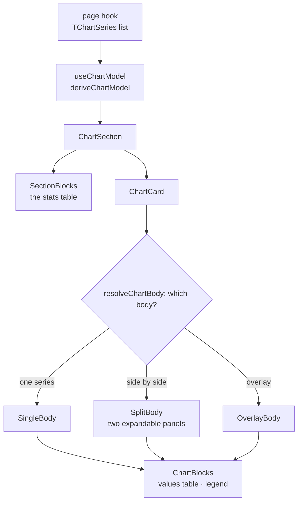
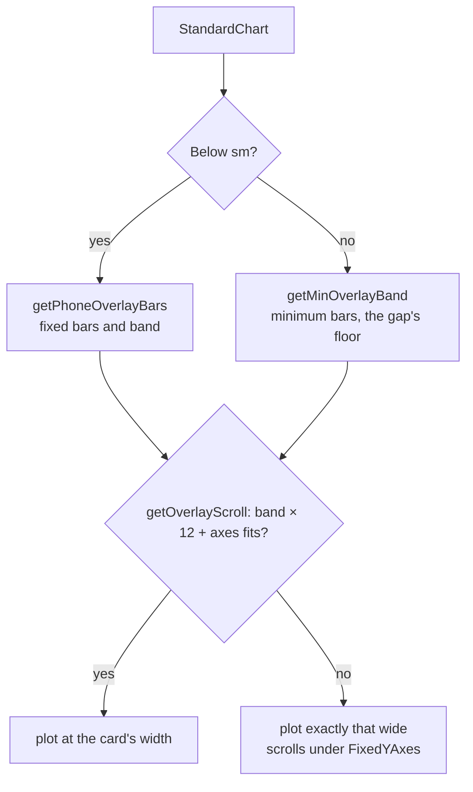

# Charts

How a chart page's chart is built: the series a page hands over, the model derived from them,
and the chart section that draws them. The page side is in [pages.md](pages.md).

## Series

A chart draws a list of [`TChartSeries`](../src/types/charts/series.type.ts): one monthly dataset
each, with its label, context line, marker, altitude and own data state (weather years load one by
one).

| Page                      | Series                        | Kind            |
| ------------------------- | ----------------------------- | --------------- |
| City Climate              | one city                      | `city`          |
| Compare Cities            | cities A and B                | `city`          |
| Compare Periods (Climate) | periods A and B of one city   | `climatePeriod` |
| Compare Periods (Weather) | 2–5 weather years of one city | `weatherYear`   |

What a kind means is in [`SERIES_KIND_RULES`](../src/constants/series.constant.ts) (`canShade`,
`titleSource`, `isSingleYear`, `hasSeriesChips`, `hasMeanLine`). The chart decides from these
rules and the page's features, never from the page or the number of series.

### Marker identity

An entity's marker — its curves' shape, its bars' hatch, its shades step — is one slot
(`markerSlot`, [`getEntityMarker`](../src/utils/seriesShape.util.ts)). Everything that draws an
entity reads the series' marker, never its place in a list. A and B are slots 0 and 1
(`getPairMarker`).

Compare Periods' years get a slot when added (`useMarkerSlots`, `assignMarkerSlots`) and keep it
through sorting and through other years being added or removed; a removed year frees its slot for
the next one. Markers are tied to the year so a year never changes its look while the reader
compares. The slots are in the URL (`markers`, written only when they differ from the list's
order), so the sidebar's chips ([`useComparedYears`](../src/hooks/filters/useComparedYears.ts))
show the same markers.

### Sort order (Compare Periods)

One page-level direction, oldest first by default (`order`,
[`sortYears`](../src/utils/periodSort.util.ts); climate periods by start year). The series are
built in it, so every list follows: the stats table's columns, both sets of chips, the bars in a
month, the values table, the legend, the export. The stats table's corner cell toggles it
(`features.seriesSort`). The `periods` filter keeps the order years were added in — the default
side-by-side pair is its first two. A year just added flashes once where it lands
(`useArrivalFlash`). Compare Cities keeps A, B.

## Model

[`deriveChartModel`](../src/utils/chartModel.util.ts) (via `useChartModel`) derives per series
the months with their mean, the aridity, the annual summary (null while a month is missing), the
stats and the Walter-Lieth series; and, shared by all, the scales, the precipitation axis' top and
the Walter-Lieth domain. The page derives it once; the card, the stats table and the export all
read it.

## View state and features

Both types are in [`chartPage.type.ts`](../src/types/charts/chartPage.type.ts).

- **View state** (`TChartViewState`, from the URL): chart mode, layout, shading, expanded panel,
  side-by-side pair, the overlay's shown series, variables and months. An absent part isn't
  offered (no layout: no layout switch).
- **Features** (`TChartFeatures`, what the page enables): title, the stats table's difference
  (`minuendId`, `meaning`), side pickers, month badge, raw export, `hiddenBlocks`, `seriesSort`.

## Chart section and card

[`ChartSection`](../src/components/charts/ChartSection.tsx) — the only export of
`components/charts` — also draws the export menu and, while loading, the skeletons; empty and
error messages are the page layout's. [`ChartCard`](../src/components/charts/ChartCard.tsx) draws
the header (title, switches, toolbar) above the body and crossfades when chart type, layout or
data changes. Every page uses the same card and frame, with the `PANEL` padding (smaller below
`sm`). A Walter-Lieth overlay of a shadable pair needs both series complete; otherwise the side by side
shows the diagram next to the other's notice.

**Toolbar** ([`ChartToolbar`](../src/components/charts/ChartToolbar.tsx)): one row outside the
crossfade — entity chips on the left, the view's controls on the right (variable chips in
standard; the guide, under the shading control for a shadable pair, in Walter-Lieth). Both slots
keep one height across views, so switching views never moves the chart. From `sm` the chips give
way first (scrolling down to 10rem), then the controls wrap below; below `sm` the controls sit
under the chips in one sideways-scrolling row.

### Phone (below `sm`)

- **Header:** title on the left, wrapping (a pair's names wrap whole, never cut); switches on the
  right, top-aligned.
- **Plot:** about 1 : 1.1, narrow axes (`getAxisStyle(…, isNarrow)`), four round ticks per
  standard axis whose span is the domain (`getStandardYAxes`), one-letter month initials from the
  locale (`formatMonthLabel`), single-series bars 55 % of the month, curves 2.2 px. One series
  never scrolls.
- **Comparison bars** (`PHONE_OVERLAY_BARS`): fixed widths instead of squeezing the year — 14 px
  up to three entities, 12 px from four, 3 px apart, 20 px between months. A year that doesn't fit
  scrolls sideways from January (`getFixedOverlayBarLayout`).

### Touch

Touch is the input, not the width: `TOUCH_MEDIA_QUERY` (`(hover: none) and (pointer: coarse)`,
`useIsTouch`), passed to the plots by `ChartDeviceContext`.

1. [`MonthTapLayer`](../src/components/charts/MonthTapLayer.tsx) covers each plot. A tap in a
   month's column selects it; another month moves it; the same month or a tap outside the plot
   clears it.
2. The selected month shows its band and the normal tooltip, pinned to the plot's top
   (`getTouchTooltipProps`; in a scrolling plot, at its visible left).
3. A horizontal drag scrubs months (`touch-pan-y` keeps vertical page scroll); a sideways-scrolling
   plot keeps its own drag and takes taps only.
4. Entity chips only toggle visibility — a tap must not leave a series focused.

With a mouse: tooltips, hover focus and the month band, as usual.

## Inside the card

### Standard chart

A Recharts `ComposedChart` with °C left (the model's scales) and mm right (0 to `rightMax`). The
two axes aren't tied, unlike Walter-Lieth's ([climate-indices.md](climate-indices.md)).

- **Colours:** semantic only; an entity is told apart by its shape
  ([colors.md](colors.md#entities-shapes-and-hatches-not-colours)).
- **One series** ([`StandardClimateChart`](../src/components/charts/StandardClimateChart.tsx), also
  each split panel): bars by aridity, max / mean / min lines.
- **Several series** ([`StandardChart`](../src/components/charts/StandardChart.tsx), the overlay):
  per entity its bars side by side and its lines with points in its shape. Line style tells the
  variables apart (`CHART_LINE_DASH`).
- **Variable chips** ([`useVisibleSeries`](../src/hooks/charts/useVisibleSeries.ts)): start from
  the variables filter and follow it; the last one on is locked. Card-level UI state, kept across
  layouts and chart types; Walter-Lieth ignores it.
- **Month filter:** months outside it are dimmed, not removed.

### Overlay and side by side

- **Overlay** ([`OverlayChart`](../src/components/charts/OverlayChart.tsx)): every drawn series on
  shared scales. Weather years get series chips
  ([`SeriesChips`](../src/components/charts/SeriesChips.tsx), the URL's `shownYears`); a hidden
  year keeps its marker.
- **Side by side** ([`SplitPanels`](../src/components/SplitPanels/SplitPanels.tsx)): two panels on
  the same scales or domain. The pair is the URL's `pair` (side pickers) or the first two
  (`getSplitPair`).
- **Expand:** a panel can fill the card, with a switch to the other series (the URL's `expanded`).
  A Walter-Lieth panel expands only when its series is complete. Exports draw the expanded panel
  with the full stats table.

### Overlay: layout, focus and scroll

[`StandardChart`](../src/components/charts/StandardChart.tsx) holds layout and focus;
`OverlayBars` and `OverlayCurves` draw the layers.

- **Bar layout** ([`getOverlayBarLayout`](../src/utils/overlayBars.util.ts)): one source for the
  bars, the curve points, the export and the settings preview. Each month's group is centred, bars
  in entity order at the bar style's gap; hidden entities take no place. The visible bars share
  70 % of the band up to 28 px each; below that the gap between groups gives way down to 8 px bars;
  below that the plot scrolls.
- **Anchored points:** each entity's points sit over its own bar (its own hidden x axis, offset by
  `getCurveOffsets`).
- **Focus** (`getEntityRole`): hovering or focusing a chip, a curve, a bar or a values-table row
  header focuses its entity. The others become context — thin gray curves without points, gray
  bars without swatch, muted table values. Never in exports.
- **Tooltip:** a hovered curve or bar names its variable, entity, month and value
  ([`useOverlayFocus`](../src/hooks/charts/useOverlayFocus.ts)).
- **Scroll:** see [Fit or scroll](#fit-or-scroll).
- **Margins and the values table:** the plot's side margins are its axes' widths
  (`getPlotMargin`), and the values table's header column takes the left one's width. That keeps
  every value under its month, including when the table scrolls with the plot (`useScrollSync`).

### Fit or scroll

Purely by width; an overflow within `FIT_TOLERANCE` (subpixel layout) still fits. The bars are then laid
out by `getOverlayBarLayout` (or `getFixedOverlayBarLayout` on a phone); a scrolling plot shows a
swipe hint and its values table scrolls with it.

### Bar styles

The reader's `chartBarStyle` setting ([settings.md](settings.md)) decides how a comparison
overlay's bars tell entities apart (`OVERLAY_BAR_STYLES`):

| Style             | Fill                      | Hatch | Gap               |
| ----------------- | ------------------------- | ----- | ----------------- |
| `plain` (default) | humid / arid              | no    | 3 px, down to 1.5 |
| `shades`          | the entity's step of each | no    | 2 px              |
| `hatch`           | humid / arid              | yes   | 1 px              |

`ChartCard` reads the setting, so open charts redraw at once. Side by side, single-city charts and
Walter-Lieth ignore it. Exports are always plain (`EXPORT_BAR_STYLE`), the best for print.

- **Plain's gap** (`getOverlayGap`) shrinks toward its floor as the bars near their minimum
  width, so plain never forces a scroll that a smaller gap would avoid.
- **Swatches** follow one rule, `getSwatchBarStyle`: an entity shows its bars' swatch beside its
  shape only where the view draws per-entity bars — the standard overlay, precipitation shown,
  `shades` or `hatch`. Elsewhere the shape alone. Chips, legend, values table, bar tooltip and
  export all ask it.

### Hover sync

One hovered month per card (`activeMonthIndex` in `ChartCard`; on touch, the tapped one). It shows
as a band on every plot, the month's dots standing out, other months' bars dimmed, and its column
in the values table. The card's charts share a Recharts `syncId`.

### Tooltips

Values in the text colour; series by shape or swatch, never colour.

| Tooltip              | Chart                    | Shows                                                                   |
| -------------------- | ------------------------ | ----------------------------------------------------------------------- |
| `StandardTooltip`    | standard                 | the month's lines and bars; in an overlay, a hovered curve or bar alone |
| `WalterLiethTooltip` | one Walter-Lieth diagram | temperature, precipitation and the month's period                       |
| `OverlayTooltip`     | Walter-Lieth overlay     | per series its marker, name and values                                  |

### Monthly values table

[`MonthlyValuesTable`](../src/components/MonthlyValuesTable/MonthlyValuesTable.tsx) shows each
month's mean temperature and precipitation, one column under each month of the plot. Its layout
follows the width the chart gives it (a container query): below 30rem a disclosure opens a
vertical table instead. It has no row hover: it highlights the hovered month's column.

In the standard overlay (`hasSections`) each unit is a section, and rows are headed by short
labels (`getEntityShortLabels`: 1967, ’70–’00, MAD). The header column is the plot's left axis
width, so longer labels are cut, with the full name in the title. Hovering a header focuses its
entity. The Walter-Lieth overlay keeps the unit in each row, with the entities' markers.

## Chart blocks

Everything drawn under or around a chart is a block in `CHART_BLOCKS`
([`ChartBlocks.tsx`](../src/components/charts/ChartBlocks.tsx)), typed so every `EChartBlock`
member needs an entry:

| Block          | Placement | Where                                      |
| -------------- | --------- | ------------------------------------------ |
| `VALUES_TABLE` | `PANEL`   | under every chart, one per split panel     |
| `LEGEND`       | `BODY`    | once under the body                        |
| `STATS_TABLE`  | `SECTION` | above the card, with the difference column |

Bodies place `<ChartBlocks>`; none renders a block itself. `PANEL` and `BODY` blocks get the block
context (`TChartBlockContext`); `SECTION` blocks get the model and features. A page leaves a block
out via `hiddenBlocks` (City Climate: the stats table).

The stats table's Difference header explains its formula in a popover (`DIFFERENCE_NOTE_KEYS`). A
clipped series name opens its full name ([`useIsTruncated`](../src/hooks/ui/useIsTruncated.ts)).

**Adding a block:** add an `EChartBlock` member, write its component in `ChartBlocks.tsx`, add its
`CHART_BLOCKS` entry (the build fails until you do). It then appears under every chart; a page
opts out with `hiddenBlocks`. Exports have their own builders ([export.md](export.md)).

## Exports

The export menus ([`useSingleChartExport`](../src/hooks/charts/useSingleChartExport.ts),
[`useComparisonChartExport`](../src/hooks/charts/useComparisonChartExport.ts)) build from the same
model as the screen and follow its view. The pipeline is in [export.md](export.md).

## Data updates

The page's `update` goes to [`DataUpdateProvider`](../src/components/DataUpdate/DataUpdateProvider.tsx).
New data replacing shown data is an update; a first load or an unchanged refetch isn't. A card
flashes when an update changed one of its series (`flashKeys`); the chart card dims with a
progress bar while an update takes longer than `MOTION.UPDATE_LOADING_DELAY_MS`; each update is
announced once in a polite live region.
