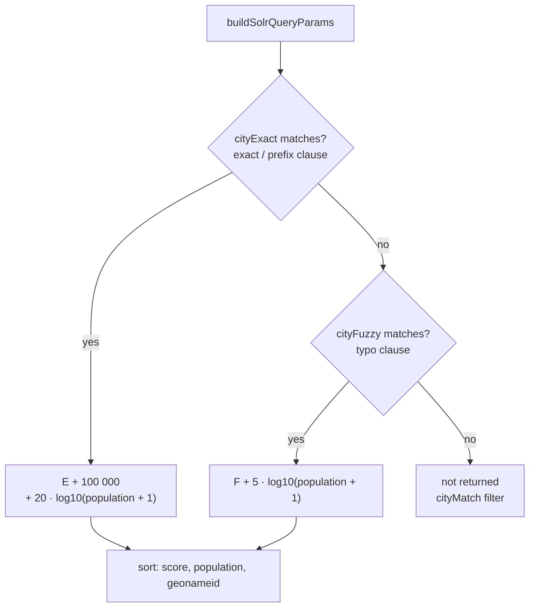

# City search

How a typed name becomes a ranked list of cities. Route, cache and errors: [backend.md](backend.md). Rebuilding the index: [operations.md](operations.md).

The request's path (debounce, Redis, Wikidata for coordinates) is in
[architecture.md](architecture.md#city-search); `SolrService.searchCities` de-duplicates the
results by `geonameid` and returns each city's label in the reader's language.

## Index

Built from GeoNames by [`prepare_data.py`](../docker/solr/scripts/prepare_data.py), schema by [`generate_schema.py`](../docker/solr/scripts/generate_schema.py).

| Field          | Holds                                                                                                                                                                        | Used for               |
| -------------- | ---------------------------------------------------------------------------------------------------------------------------------------------------------------------------- | ---------------------- |
| `label_<lang>` | One name per locale: first alternate name, replaced by a preferred one; never colloquial or historic. Fallback: default name → ASCII name (Ukrainian: → English label first) | Display, ranking boost |
| `names`        | Every name in the app's locales + default + ASCII name; historic kept, colloquial dropped                                                                                    | Search                 |
| `names_prefix` | Copy of `names` with edge n-grams                                                                                                                                            | Search while typing    |

Labels and search names are separate because a reader types any name they know ("Київ" in an English UI, "Paris" in a Ukrainian one), but sees one name in their language.

## Analysis

Same chain for the index and the query:

```
remove apostrophes (' ’ ʼ ` ´) → split into words → ICU folding (lowercase, no diacritics, any script)
                                                   → names_prefix only, index only: word beginnings, 2–25 chars
```

`Кам’янець` → `камянець` · `München` → `munchen` · `Αθήνα` → `αθηνα` · `kyiv` → `ky`, `kyi`, `kyiv`

## Query

Two clauses; a city is returned if either matches. Every word must match in both (`mm=100%`).

| Clause         | Fields                                                           | Text                                              |
| -------------- | ---------------------------------------------------------------- | ------------------------------------------------- |
| Exact / prefix | `names_prefix`, `names^4`, `label_<locale>^8`; phrase `names^10` | As typed                                          |
| Typo           | `names^3`, `names_prefix`                                        | Split on spaces and hyphens, each word → `word~N` |

Edits per word (Damerau–Levenshtein, OSA: insert, delete, replace, swap neighbours):

| Word length | < 4 | 4–7 | ≥ 8 |
| ----------- | --- | --- | --- |
| Edits       | 0   | 1   | 2   |

Hyphens are split because a fuzzy term isn't tokenized: `sant-denis~2` never matches `saint` + `denis`.

## Score



`q = {!bool filter=$cityMatch should=$cityExact should=$cityRank}`: `cityMatch` keeps a city when
either clause matches; `cityRank` adds the tier and the population boost (E, F: each clause's own
score).

- **100 000** puts every exact hit above every typo hit; a unit test checks it against the largest
  possible typo score (`SOLR_SCORE_BOUNDS`).
- **Population 20** keeps the established exact order (Paris, France first); **5** in the typo
  tier makes closeness matter more than size.

## Where ranking lives

All weights, tiers, `mm` and sort are in [`solr.constant.ts`](../src/constants/solr.constant.ts) and sent with every query. The handler keeps only neutral defaults, because nested `{!edismax}` clauses inherit same-named request parameters, handler defaults included. For the same reason the app's parameters are named `city…`, and the reader's text is passed by reference (`v=$cityQ`), never pasted into query syntax. Top level: `defType=lucene`, the only parser that accepts `{!…}` in `q`.

## Limits

- At most 2 edits per word; words under 4 characters must be exact or a prefix.
- No phonetic matching: "Kiev" works only because it's a GeoNames name of Kyiv.
- An exact hit beats a closer typo: "lvov" lists L’vov (RU) before Lviv.
- In the typo tier, a larger city slightly further away can outrank a closer small one.
