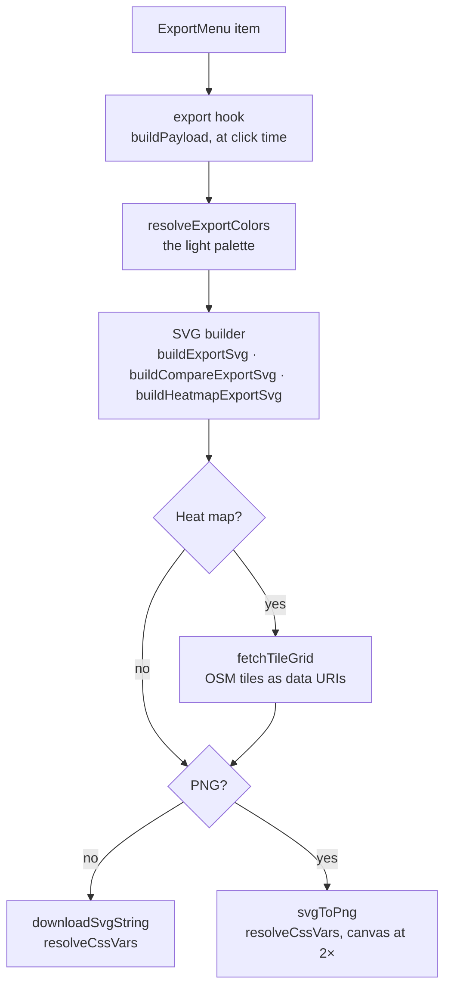

# Export

How the export menu turns the screen into a file: CSV, PNG and SVG, raw data, and the heat map
with its basemap. Every image is an SVG string from pure builders, never captured from the DOM, so
it's the same in either theme and at any window size.

## What each page exports

| Page                            | Hook                                                                          | CSV                            | PNG / SVG               | Raw                             |
| ------------------------------- | ----------------------------------------------------------------------------- | ------------------------------ | ----------------------- | ------------------------------- |
| City Climate                    | [`useSingleChartExport`](../src/hooks/charts/useSingleChartExport.ts)         | monthly values                 | `buildExportSvg`        | CSV and JSON, Climate 1970–2000 |
| Compare Cities, Compare Periods | [`useComparisonChartExport`](../src/hooks/charts/useComparisonChartExport.ts) | stats, a column per series     | `buildCompareExportSvg` | —                               |
| Region Heatmap                  | [`useHeatMapExport`](../src/hooks/pages/useHeatMapExport.ts)                  | a row per cell: lat, lng, mean | `buildHeatmapExportSvg` | —                               |

[`ExportMenu`](../src/components/UI/ExportMenu) is disabled while data is being replaced, so a
file never mixes old and new data, and on a single chart while a month is missing. Filenames
([`buildFilename`](../src/utils/export.util.ts)): page, names, date, slugged.

## From click to file

- The payload comes from the same model and stats table as the screen, so it follows the view:
  chart type, layout, shading, expanded panel, drawn years, variable chips, month filter. Only
  series with data; for weather years only those drawn.
- `resolveCssVars` replaces every `var(--token)` left in the markup: a saved SVG has no
  stylesheet. The PNG is the same SVG rasterised, so the two never differ.
- Builders live in [`src/utils/export/svg/`](../src/utils/export/svg); the heat map's tiles are
  fetched inside its map section ([below](#heat-map-image)).

## Colours: the export palette

Exports use the light palette whatever the theme, so the same view exports the same file.
[`readExportPalette`](../src/utils/export/shared/exportPalette.util.ts) appends a hidden probe with
`data-export-palette`; `tokens.css` declares the light semantic tokens on
`:root, [data-export-palette]`, so the probe ignores `html.dark`. Colours are read from the live
DOM, which is why a payload is never built during render.

## The image

1000 px wide, height by content (layouts in [`export.constant.ts`](../src/constants/export.constant.ts)):

- **Header:** title and subtitle.
- **Stats:** the single chart's stats row, or the page's comparison table — complete even when a
  panel is expanded.
- **Chart body:** the Walter-Lieth diagram drawn with the screen's geometry functions
  (`getSharedDomain`, `getAridHumidSegments`, …), so hatching and crossings match; or the standard
  chart. Missing months break a line. An incomplete series is drawn as its notice.
- **Standard overlay:** the full year, never scrolled, always in the plain bar style
  (`EXPORT_BAR_STYLE`); a legend names every entity even where the page's chips stand in for it.
- **Monthly values:** the screen's rows (`buildMonthlyValuesRows`), columns under the months. A
  file can't switch to the vertical layout, so the font shrinks to fit (never below 8 px).
- **Legend:** the screen's items and swatches (`buildExportLegend`).
- **Footer:** context, data attribution (creator and version read live from WorldClim,
  `useGetDatasetVersion`) and the view's share URL.

Truncated text is measured on a canvas in the export's font (`measureExportText`). The XML
declaration must be the first character, so builders join an array of lines.

## Raw data

City Climate's raw CSV and JSON carry every variable WorldClim has for the place (`srad`, `wind`,
`vapr` too), with coordinates, altitude, grid, dataset and period. Those variables exist only for
Climate 1970–2000, so raw export is offered only there; one check
(`isFullVariableDataAvailable`) gates both the menu and the fetch. Fetched on click.

CSVs are UTF-8 with a BOM (so spreadsheets read `°C`). A missing value is an empty cell (monthly)
or "—" (stats), never 0.

## Heat map image

[`buildHeatmapExportSvg`](../src/utils/export/svg/buildHeatmapExportSvg.util.ts): header, stats
row, map, colour scale. The map section
([`buildHeatmapMapSection`](../src/utils/export/svg/buildHeatmapMapSection.util.ts)):

- **Its own view:** fitted to the selection plus 10 % padding (`computeFitZoom`), not the live
  map's pan and zoom, so a region always exports the same picture.
- **Tiles:** OSM tiles one zoom finer to match the 2× PNG, or at the fitted zoom past
  `HEATMAP_EXPORT_TILE_LIMITS`; each inlined as a data URI
  ([`fetchTileGrid`](../src/utils/export/svg/mapTiles.util.ts)), since an external `href` doesn't
  load once rasterised. A failed, timed-out or blocked tile becomes a neutral rectangle.
- **Cells and outline:** projected through the tiles' zoom and origin, so nothing drifts.
- **Attribution:** "© OpenStreetMap contributors", as OSM's licence requires.

## Adding something to an export

- A block that belongs in the image: a builder in `src/utils/export/svg/` taking its rows and
  `TExportChartColors`, placed in `buildExportSvg` and `buildCompareExportSvg` (each part returns
  its bottom; the next starts there).
- A new colour: add it to `CSS_VAR_MAP` and `TExportChartColors`, or pass `var(--token)` and let
  `resolveCssVars` resolve it. Never a hex value in a builder.
- Tests: builders are pure; test the SVG string ([`tests/unit/utils/export/`](../tests/unit/utils/export)).
