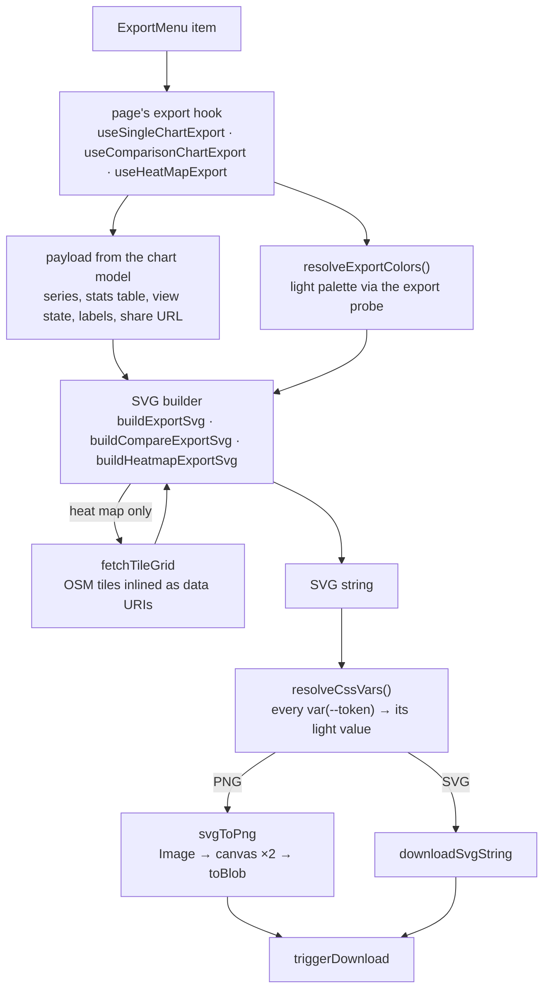

# Export

How the export menu turns what's on screen into a file: CSV tables, PNG and SVG images, the
raw data, and the heat map with its basemap. Every image is built as an SVG string by pure
builders, never captured from the DOM, so the image is the same in either theme and at any
window size. Which menu a page has is in [charts.md](charts.md); the colour rules in
[colors.md](colors.md).

## What each page exports

| Page                            | Hook                                                                          | CSV                                         | PNG / SVG                                                                        | Raw                                  |
| ------------------------------- | ----------------------------------------------------------------------------- | ------------------------------------------- | -------------------------------------------------------------------------------- | ------------------------------------ |
| City Climate                    | [`useSingleChartExport`](../src/hooks/charts/useSingleChartExport.ts)         | monthly values of the chart's variables     | [`buildExportSvg`](../src/utils/export/svg/buildExportSvg.util.ts)               | CSV and JSON, Climate 1970–2000 only |
| Compare Cities, Compare Periods | [`useComparisonChartExport`](../src/hooks/charts/useComparisonChartExport.ts) | per-series stats, one column per series     | [`buildCompareExportSvg`](../src/utils/export/svg/buildCompareExportSvg.util.ts) | —                                    |
| Region Heatmap                  | [`useHeatMapExport`](../src/hooks/pages/useHeatMapExport.ts)                  | one row per cell: `lat`, `lng`, annual mean | [`buildHeatmapExportSvg`](../src/utils/export/svg/buildHeatmapExportSvg.util.ts) | —                                    |

The menu itself is [`ExportMenu`](../src/components/UI/ExportMenu). It's disabled while data
is being replaced (`exportMenu.updating`), so a file never mixes old and new data, and on a
single chart while a month is missing (`exportMenu.incompleteData`: the stats and the
Walter-Lieth diagram need every month).

Filenames come from [`buildFilename`](../src/utils/export.util.ts): the page, the place or
series names and today's date, lowercased into a slug (`compare-cities-rome-oslo-2024-01-15.png`).

## From click to file

1. **Payload.** The hook builds the payload from the same chart model and stats table the
   screen draws ([charts.md](charts.md)), so the export follows the page: chart type, layout,
   shading, the expanded panel, the drawn weather years, the variable chips and the month
   filter. Comparison exports keep only the series with data; weather years only those the
   screen draws (the pair side by side, the shown years in the overlay).
2. **Colours.** [`resolveExportColors`](../src/utils/export/svg/resolveExportColors.util.ts)
   reads the chart colours the builders need as real values (`TExportChartColors`).
3. **SVG.** A builder returns the markup and its height. Builders are pure functions of the
   payload and colours, in [`src/utils/export/svg/`](../src/utils/export/svg).
4. **Token resolution.** Before saving, [`resolveCssVars`](../src/utils/export/shared/exportPalette.util.ts)
   replaces every `var(--token)` left in the markup (a series' colour reaches the builders as
   a token reference) with its value. A saved SVG has no stylesheet to resolve them.
5. **File.** SVG is downloaded as it is; PNG goes through
   [`svgToPng`](../src/utils/export/raster/svgToPng.util.ts): the SVG is loaded as an image
   and drawn on a canvas at twice its size (`EXPORT_PNG_SCALE`). The PNG is rasterised from
   the exact same document, so PNG and SVG never differ.

## Colours: the export palette

Exports always use the light palette, whatever the reader's theme, so the same view exports
the same file. [`readExportPalette`](../src/utils/export/shared/exportPalette.util.ts) appends
a hidden probe carrying `data-export-palette`; `tokens.css` declares the light semantic tokens
on `:root, [data-export-palette]`, so the probe's computed values ignore `html.dark`. Both
`resolveExportColors` and `resolveCssVars` read through it, and so do the heat map's scale
stops. Details in [colors.md](colors.md).

Colours are read at click time from the live DOM (`getComputedStyle`), which is why a payload
is never built during render.

## The image

Every image is 1000 px wide (`EXPORT_SVG_SHARED_LAYOUT`) and its height follows its content.
The layouts and sizes are in [`export.constant.ts`](../src/constants/export.constant.ts).
Top to bottom:

- **Header:** the title (the place or series names) and subtitle (dataset and period).
- **Stats:** the single chart's stats row, or the comparison's stats table
  ([`buildComparisonTableSvg`](../src/utils/export/svg/comparisonTableExport.util.ts) for a
  pair, with the difference column and Martonne badges; one column per year for weather
  years). It's the page's table and stays complete even when a panel is expanded.
- **Chart body:** the Walter-Lieth diagram (single, split or overlay —
  [`walterLiethExport.util.ts`](../src/utils/export/svg/walterLiethExport.util.ts),
  [`buildCompareWalterLiethSvg.util.ts`](../src/utils/export/svg/buildCompareWalterLiethSvg.util.ts))
  or the standard chart ([`buildStandardSplitSvg.util.ts`](../src/utils/export/svg/buildStandardSplitSvg.util.ts),
  [`compareChartParts.util.ts`](../src/utils/export/svg/compareChartParts.util.ts)). The
  diagram uses the same geometry functions as the screen — `getSharedDomain`,
  `getAridHumidSegments`, `getHatchGeometry`, `getFrostBand` ([climate-indices.md](climate-indices.md)) —
  so the hatching and crossings match. Missing months break a line instead of bridging it
  (`buildGapAwarePath`). An incomplete Walter-Lieth series is drawn as its notice.
- **Monthly values:** [`buildMonthlyValuesSvg`](../src/utils/export/svg/monthlyValuesExport.util.ts),
  the screen's values table under each plot, its columns exactly under the months, built from
  the same rows (`buildMonthlyValuesRows`). A file can't switch to the vertical layout, so
  where a column is too narrow for its longest value the strip's font shrinks to fit
  (`fitValueFontSize`, never below 8 px).
- **Legend:** [`buildExportLegend`](../src/utils/export/svg/legendExport.util.ts), the same
  items and swatches as the screen's `ChartLegend`, wrapped into centred rows.
- **Footer:** [`buildFooterTextLines`](../src/utils/export/shared/footerLines.util.ts): the
  context, the data attribution and the share URL of this exact view. The attribution names
  WorldClim's and CRU-TS's creator and version, read live from WorldClim's raster resources
  ([`useGetDatasetVersion`](../src/hooks/data/useGetDatasetVersion.ts)), not hard-coded. The
  URL shrinks to fit one line, down to 10 px, and wraps below that.

Text cut to fit (a long row label, ellipsised) is measured on a canvas in the export's font
stack (`measureExportText`, [`textWrap.util.ts`](../src/utils/export/svg/textWrap.util.ts)); word
wrap and the footer use an average-glyph estimate (`EXPORT_TEXT.AVG_CHAR_WIDTH_RATIO`), which is
also the fallback where no canvas exists. The XML declaration must be the document's first
character, so builders join an array of lines instead of using one multi-line template.

## Raw data

City Climate's raw CSV and JSON ([`exportRawCsv`](../src/utils/export/raw/exportRawCsv.util.ts),
[`exportRawJson`](../src/utils/export/raw/exportRawJson.util.ts)) carry every variable WorldClim
has for the place — including `srad`, `wind` and `vapr` — plus its coordinates, altitude, grid,
dataset and period, for analysis elsewhere. Those extra variables exist only for Climate
1970–2000, so the menu offers raw data only there
([`isFullVariableDataAvailable`](../src/utils/export/raw/rawDataAvailability.util.ts)); the same
check gates both the menu items and the fetch, so they can't drift apart. The data is fetched on
click.

CSV files are UTF-8 with a byte-order mark, so spreadsheet apps read `°C` correctly. A missing
value is an empty cell (monthly CSV) or "—" (stats CSV), never 0.

## Heat map image

[`buildHeatmapExportSvg`](../src/utils/export/svg/buildHeatmapExportSvg.util.ts) draws the
header, the stats row (minimum, maximum, mean, median, standard deviation, cells), the map and
the colour scale's gradient. The map section
([`buildHeatmapMapSection`](../src/utils/export/svg/buildHeatmapMapSection.util.ts)):

- **Its own view.** The map is fitted to the selection's bounds plus 10% padding
  (`computeFitZoom`, [`mapProjection.util.ts`](../src/utils/mapProjection.util.ts)), not copied
  from the live map's pan and zoom, so the same region always exports the same picture.
- **Tiles.** The OpenStreetMap tiles under it are fetched one zoom level finer to match the 2×
  PNG (`resolveTileZoom`; not past OSM's maximum zoom), or at the fitted zoom when that would take more than 64 tiles
  (`HEATMAP_EXPORT_TILE_LIMITS`). Each tile is inlined as a data URI
  ([`fetchTileGrid`](../src/utils/export/svg/mapTiles.util.ts)): an external `href` doesn't load
  once the SVG is rasterised. A tile that fails, times out (5 s) or comes back as OSM's
  "blocked" image (the `x-blocked` header) becomes a neutral rectangle instead of failing the
  export. The live map's tile layer uses `crossOrigin`, so the fetch can be served from the
  browser's cache.
- **Cells and selection.** Cells and the box or polygon outline are projected through the same
  zoom and origin as the tiles, so nothing drifts, and clipped to the section. Cells are coloured
  as on the live map: the same values and range, in the light palette's scale.
- **Attribution.** "© OpenStreetMap contributors" in the map's corner, as OSM's licence
  requires.

## Adding something to an export

- **A block under every chart** that belongs in the image: after adding it to `CHART_BLOCKS`
  ([charts.md](charts.md)), add a builder in `src/utils/export/svg/` that takes its rows and
  `TExportChartColors`, and place it in `buildExportSvg` and `buildCompareExportSvg` below the
  content above it (each part returns its bottom, the next starts there).
- **A new colour:** add its token to `CSS_VAR_MAP` in `resolveExportColors.util.ts` (and its
  field to `TExportChartColors`), or pass it as `var(--token)` and let `resolveCssVars` resolve
  it. Never write a hex value in a builder.
- **Tests:** the builders are pure, so test the SVG string, as in
  [`tests/unit/utils/export/`](../tests/unit/utils/export).
