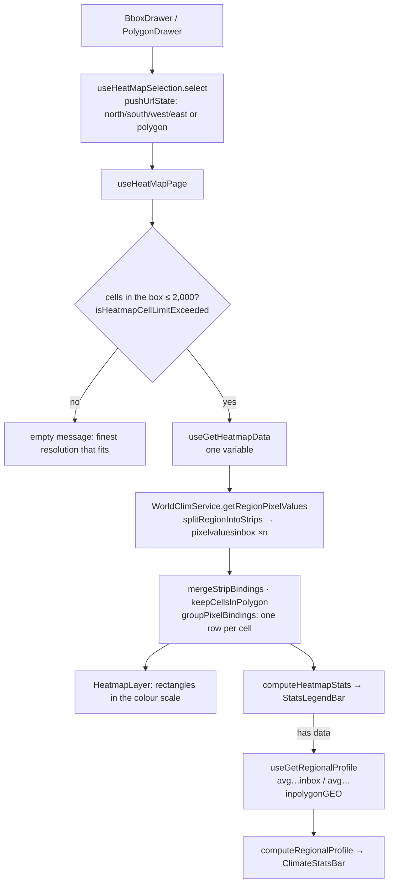

# Region Heatmap

The heat map page (`/heat-map`) shows one variable over a region the reader draws: the cells on
the map in a colour scale, the region's statistics, and its climate profile. It's the one page
without series or a chart section, so its hook returns the props of its own blocks
(`THeatMapPage`). How it fits the page pattern is in [pages.md](pages.md); the WorldClim
queries, strips and caching in [backend.md](backend.md).

## Files

| What                     | Where                                                                                                                                                                                                                          |
| ------------------------ | ------------------------------------------------------------------------------------------------------------------------------------------------------------------------------------------------------------------------------ |
| Page hook                | [`useHeatMapPage`](../src/hooks/pages/useHeatMapPage.ts)                                                                                                                                                                       |
| Region and drawing tools | [`useHeatMapSelection`](../src/hooks/pages/useHeatMapSelection.ts), [`DrawingTools.tsx`](../src/app/heat-map/_components/components/DrawingTools.tsx), [`Toolbar.tsx`](../src/app/heat-map/_components/components/Toolbar.tsx) |
| Map                      | [`MapCanvas.tsx`](../src/app/heat-map/_components/components/MapCanvas.tsx) (loaded with `dynamic(…, { ssr: false })`), [`HeatmapLayer.tsx`](../src/app/heat-map/_components/components/HeatmapLayer.tsx)                      |
| Stats and profile        | [`StatsLegendBar.tsx`](../src/app/heat-map/_components/components/StatsLegendBar.tsx), [`RegionalClimateProfile.tsx`](../src/app/heat-map/_components/components/RegionalClimateProfile.tsx)                                   |
| Pure logic               | [`HeatMap.util.ts`](../src/app/heat-map/_components/HeatMap.util.ts), [`regionQuery.util.ts`](../src/utils/regionQuery.util.ts), [`cellCount.util.ts`](../src/utils/cellCount.util.ts)                                         |
| Data hooks               | [`useGetHeatmapData`](../src/hooks/data/useGetHeatmapData.ts), [`useGetRegionalProfile`](../src/hooks/data/useGetRegionalProfile.ts)                                                                                           |
| Export                   | [`useHeatMapExport`](../src/hooks/pages/useHeatMapExport.ts) — see [export.md](export.md)                                                                                                                                      |

## From a drawn region to coloured cells

## The region

- **Drawing.** The toolbar toggles a box or a polygon mode; starting a new shape clears the
  current one. A box is a mouse drag: the map stops panning while the mode is on, and the
  cursor becomes a crosshair. A polygon is a click per vertex; with three or more, a click
  within 14 px of the first vertex closes it (`CLOSE_PX`), and the preview snaps to it. While a
  shape is being drawn, a [`CellCountBadge`](../src/components/filters/CellCountBadge.tsx) beside
  it counts the cells its box would load at the current resolution, red past the cap.
- **In the URL.** A finished shape is pushed to the URL, so Back returns to the previous region:
  a box as `north`, `south`, `west`, `east`, a polygon as WKT in `polygon`
  (`selectionUrlField` in [`HeatMap.util.ts`](../src/app/heat-map/_components/HeatMap.util.ts)).
  A polygon wins if a URL has both. Clear pushes no selection ([url-state.md](url-state.md)).
- **A picked city moves the map, it doesn't select a region.** With sync city on, a city
  picked on another page flies the map to it too (`usePersistedCityFollow`), but only on a
  change, not on the first render.

## Grid sizes and the cell cap

The resolution filter sets the cell size (`GRID_DELTA` in
[`worldclim.constant.ts`](../src/constants/worldclim.constant.ts)): 10′, 5′, 2.5′ or 30″ of arc
(labelled about 324, 81, 20 and 1 km², `CELL_SIZE_OPTIONS`); 30″ exists only for Climate
1970–2000. The heat map loads at most `FILTER_MAX_HEATMAP_CELLS` (2,000) cells, counted on the
box, or the box around a polygon, because that is what's fetched
([`countCellsInBounds`](../src/utils/cellCount.util.ts)). Cells are counted by centroid on the
global grid (`getCellIndexRange`): a cell belongs to a box when its centre is inside it.

Within the cap a region takes at most four strip requests and one for its profile. A region over it
isn't loaded: the page names the finest resolution it fits at (`getFinestLoadableGrid`,
[`useTooManyCellsMessage`](../src/hooks/pages/useTooManyCellsMessage.ts)), and for a polygon
says how many of its box's cells it covers itself (`countCellsInPolygon`). The filters
block Apply on a resolution that would exceed it ([filters.md](filters.md)).

## Requests

The region's cells come in latitude strips of at most 10,000 rows each — WorldClim's hard limit
on a region query — fetched in parallel and merged; a polygon is read from the strips of its
box, keeping the cells whose centroid is inside. Why, and how the strips are cut so the same
region always asks for the same strips, is in [backend.md](backend.md#row-limits). Each strip
is cached in Redis on its own.

The cells query asks for one variable: the first selected one (`tmax` when none). Its key is
`["heatmap", area, gridSize, variable, dataset]`, so a change of variable, resolution, period
or year refetches, while `keepPreviousData` keeps the old cells on the map meanwhile. Clearing
the selection drops them at once.

The regional profile runs only once the region has cells. It asks WorldClim for the region's
monthly averages of `tmax`, `tmin` and `prec` in one request (`getRegionAverages`), then
derives the annual values like any series
([climate-indices.md](climate-indices.md#heat-map-statistics)).

## Colour scales

[`COLOR_SCALE_STOPS`](../src/constants/colorScale.constant.ts) names two scales by their tokens:
a 9-stop RdYlBu diverging scale for temperature (blue cold, red hot) and a 4-stop sequential
scale for precipitation. Precipitation uses the precipitation scale; every other variable the
temperature one.

The scale is stretched over the region's own range: a cell's colour is its place between the
lowest and highest cell (`interpolateColor`, linear between the two stops around it,
[`colorScale.util.ts`](../src/utils/colorScale.util.ts)). A region therefore always uses the
whole scale, and the gradient under the stats is labelled with that minimum and maximum: the
colours compare cells within one region, not across regions. The stops' colours are read from
the tokens at draw time (`resolveColorScale` over `getComputedStyle`), so they follow the theme;
the export reads them from the light palette.

Each cell is a Leaflet rectangle at 55% fill opacity, so the basemap stays readable. Its value
is the mean of its twelve monthly values, or of the selected months when the `months` param
names some (`pixelSelectedAvg`); the stats and the gradient always use the annual mean. Hovering a
cell (tapping, on a touch device) shows its value and centre coordinates in a popup. When the
selection changes, the map fits itself to the new region.

## Statistics

[`computeHeatmapStats`](../src/app/heat-map/_components/HeatMap.util.ts) takes each cell's annual
mean and gives the minimum, maximum, mean, median, standard deviation (population) and cell
count, shown by `StatsLegendBar` with the gradient. The region's climate profile below is a
[`ClimateStatsBar`](../src/components/ClimateStatsBar/ClimateStatsBar.tsx): mean temperature,
annual precipitation, arid months and the De Martonne index of the region's average year.

The months filter is shown but disabled here, with a note
([`FILTER_UNAVAILABLE_NOTE_KEYS`](../src/constants/filters.constant.ts)); with Climate, the
variables available only for 1970–2000 (`srad`, `wind`, `vapr`) can't be picked either.

## Empty and error states

The page's one message ([`resolveDataState`](../src/utils/dataState.util.ts)) says, in order:
no region drawn yet, the region is over the cap, the climate period has no data at this
resolution, or no data. A failed request — the cells or the profile — shows the error message
([pages.md](pages.md#data-state-and-errors)).
