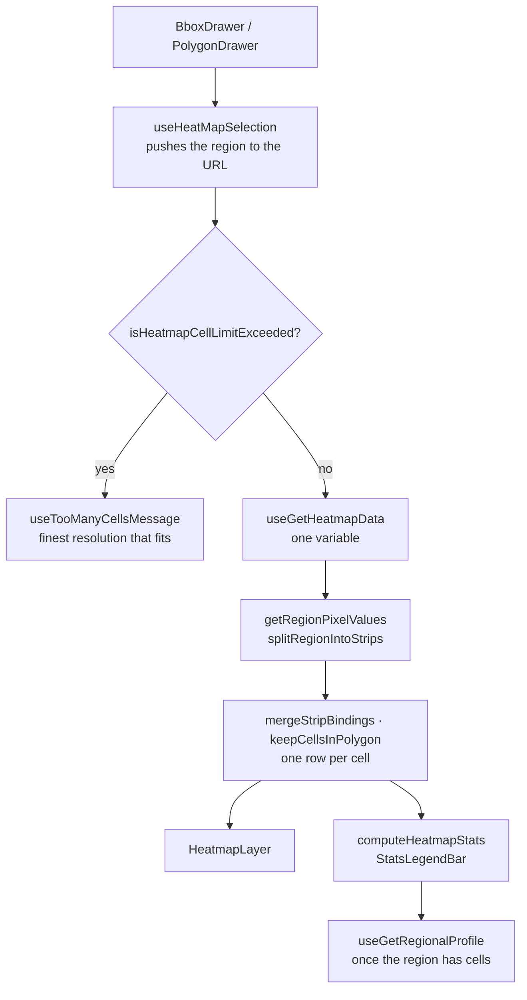

# Region Heatmap

`/heat-map` shows one variable over a region the reader draws: cells in a colour scale, the
region's statistics and its climate profile. It's the one page without series or a chart section,
so its hook returns its own blocks' props (`THeatMapPage`, [`useHeatMapPage`](../src/hooks/pages/useHeatMapPage.ts)).
WorldClim strips and caching are in [backend.md](backend.md#row-limits-and-strips).

## From a drawn region to coloured cells

Over the cap the page passes no area to `useGetHeatmapData`, so nothing is requested. Strips and
their row limit are in [backend.md](backend.md#row-limits-and-strips).

## The region

- **Drawing:** the toolbar toggles box or polygon mode; a new shape clears the old one. A box is a
  drag (the map stops panning); a polygon is a click per vertex, closed by a click near the first.
  While drawing, a [`CellCountBadge`](../src/components/filters/CellCountBadge.tsx) counts the
  cells the box would load, red past the cap.
- **URL:** a box as `north`, `south`, `west`, `east`; a polygon as WKT in `polygon` (wins if both).
  Pushed, so Back returns to the previous region.
- **A picked city moves the map**, never selects a region; with `syncCity`, a city picked elsewhere
  flies the map there on change.

## The cell cap

Resolution sets the cell size (`GRID_DELTA`: 10′, 5′, 2.5′, 30″ — the last only for Climate
1970–2000). The page loads at most `FILTER_MAX_HEATMAP_CELLS` (2,000) cells, counted on the box (a
polygon's box), because that's what's fetched ([`countCellsInBounds`](../src/utils/cellCount.util.ts));
a cell belongs to a box when its centroid is inside. Within the cap a region takes at most four
strip requests plus one for the profile.

Over the cap, the page names the finest resolution that fits (`getFinestLoadableGrid`) and, for a
polygon, how many cells the polygon itself covers, so a thin diagonal polygon says why it can't
load. The filters block Apply on a resolution that would exceed it ([filters.md](filters.md)).

## Requests

The cells query asks for the first selected variable (`tmax` when none); its key is
`["heatmap", area, gridSize, variable, dataset]`, so variable, resolution, period or year refetch,
keeping old cells meanwhile. Clearing the selection drops them at once. The profile asks for the
region's monthly averages of `tmax`, `tmin` and `prec` in one request.

## Colour scales

[`COLOR_SCALE_STOPS`](../src/constants/colorScale.constant.ts): a 9-stop RdYlBu scale for
temperature, a 4-stop sequential scale for precipitation. The scale is stretched over the region's
own range ([`interpolateColor`](../src/utils/colorScale.util.ts)), so a region always uses the whole
scale: colours compare cells within a region, not across regions. Stops are read from the tokens at
draw time (`resolveColorScale`), following the theme; the export uses the light palette.

Cells are rectangles at 55 % opacity. A cell's value is its annual mean — or the mean of the
months a `months` param names, which can arrive from another page even though the months filter
is disabled here. The stats and the gradient always use the annual mean. Hovering (tapping) a cell
shows its value and centre; a new selection fits the map to it.

## Statistics

`computeHeatmapStats` ([`HeatMap.util.ts`](../src/app/heat-map/_components/HeatMap.util.ts)) gives
the cells' minimum, maximum, mean, median, population standard deviation and count. The profile
below is a `ClimateStatsBar` of the region's average year (mean temperature, precipitation, arid
months, De Martonne — [climate-indices.md](climate-indices.md)).

The months filter is disabled here, and with Climate the 1970–2000-only variables can't be picked.

## Empty and error states

One message ([`resolveDataState`](../src/utils/dataState.util.ts)), in order: no region yet, over
the cap, no data for the period at this resolution, no data. A failed cells or profile request
shows the error ([pages.md](pages.md#data-state-and-errors)).
