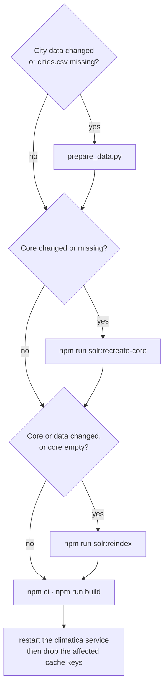

# Operations

Running the app locally and keeping an environment current: Docker services, environment
variables, the Solr city index, npm scripts, CI and deployment.

## Docker services

[`docker/docker-compose.yml`](../docker/docker-compose.yml) (project `climatica`):

| Service           | Image            | Port | Data                                                                                          |
| ----------------- | ---------------- | ---- | --------------------------------------------------------------------------------------------- |
| `climatica-solr`  | `solr:8`         | 8983 | volume `solr_data`; creates the `cities` core on first start with the repo's `solrconfig.xml` |
| `climatica-redis` | `redis:7-alpine` | 6379 | volume `redis_data`, append-only                                                              |

`docker:up` starts them, `docker:stop` / `docker:down` stop them (volumes kept), `docker:reset`
removes containers **and volumes**, `docker:reboot` resets and starts (then reindex),
`docker:logs` follows the logs.

## Environment variables

Validated at startup in [`src/libs/Env.ts`](../src/libs/Env.ts); copy
[`.example.env`](../.example.env) to `.env`. Code reads `env` from `@/libs/Env`, never `process.env`.

| Variable               | Side   | Default                         | Purpose                                         |
| ---------------------- | ------ | ------------------------------- | ----------------------------------------------- |
| `WORLDCLIM_API_KEY`    | server | required                        | WorldClim bearer key, never sent to the browser |
| `REDIS_URL`            | server | `redis://localhost:6379`        |                                                 |
| `SOLR_URL`             | server | `http://localhost:8983`         | also used by `solr:schema`                      |
| `PORT`                 | server | `3000`                          | dev port; the server-side axios base URL        |
| `NEXT_PUBLIC_SITE_URL` | client | `https://climatica.gsic.uva.es` | absolute URLs: metadata, share links, OG images |

## First-time setup

1. `npm install`; create `.env`.
2. Download GeoNames' [`allCountries.zip`](https://download.geonames.org/export/dump/allCountries.zip)
   and [`alternateNamesV2.zip`](https://download.geonames.org/export/dump/alternateNamesV2.zip) into
   `docker/solr/data/` (gitignored).
3. `python3 docker/solr/scripts/prepare_data.py` — builds `cities.csv` (populated places and
   capitals; a label column per locale and a search-names column, [city-search.md](city-search.md#index)).
4. `npm run docker:up`; wait for Solr's healthcheck.
5. `npm run solr:reindex` (a few minutes).
6. `npm run dev`.

## Solr reindex

`npm run solr:reindex` = `solr:schema` (applies only what differs between
[`schema.json`](../docker/solr/schema.json) and Solr's schema; safe to repeat) + `solr:import`
(posts `cities.csv`, splitting `names` on `|`). `schema.json` is generated from `locales.json` by
`generate_schema.py` and committed.

## After pulling changes

| What changed                                                                     | Run                                            |
| -------------------------------------------------------------------------------- | ---------------------------------------------- |
| `solrconfig.xml`, `schema.json`, `generate_schema.py`, or the core fails to load | rebuild the city index (below)                 |
| `src/configs/locales.json` or `prepare_data.py`                                  | `prepare_data.py`, then `npm run solr:reindex` |
| the search query (`solr.util.ts`, `solr.constant.ts`)                            | `npm run cache:clear-city-search`              |
| `.example.env`                                                                   | add the new variable to `.env`                 |

### Rebuilding the city index

A core keeps the `solrconfig.xml` it was created with, and `solr:schema` never removes fields, so
a change to field types, the config or the CSV's columns needs a new core:

1. `prepare_data.py`, if the inputs changed or `cities.csv` is missing.
2. `npm run solr:recreate-core` — checks the image has the ICU libraries, then unloads and
   recreates the `cities` core from the repo's `solrconfig.xml`. It copies the file in because the
   container's configset is a single-file bind mount, which keeps reading the old file after a
   checkout. Redis is untouched.
3. `npm run solr:reindex`.
4. `npm run cache:clear-city-search` (and `cache:clear-nearest-city` after a core or data change).
   Never delete `city-search-counter:*`: the counters decide which queries earn the longer cache
   ([backend.md](backend.md#redis-caching)).

Search is empty or partial from step 2 until the import commits. Other cached responses survive
deploys; after a change to what an API returns, `docker exec climatica-redis redis-cli FLUSHDB`
(this also resets rate-limit and popularity counters).

## npm scripts

| Script                                                | Does                                                       |
| ----------------------------------------------------- | ---------------------------------------------------------- |
| `dev`, `build`, `start`                               | Next.js                                                    |
| `check`                                               | type-check, lint, format check (`format` fixes formatting) |
| `test`, `test:watch`, `test:coverage`                 | Vitest ([testing.md](testing.md))                          |
| `test:e2e`, `test:e2e:ui`, `test:e2e:debug`           | Playwright; needs the Docker services                      |
| `test:python`                                         | the Solr data script's pytest suite (`.venv`)              |
| `cache:clear-city-search`, `cache:clear-nearest-city` | delete `city-search:*` / `nearest-city:*` (not counters)   |

Node's version is [`.nvmrc`](../.nvmrc), read locally and by CI; npm's is `packageManager`. The
lock must be written by that npm: npm 10's `npm ci` rejects a lock written by npm 11 that omits an
optional peer dependency.

## CI and deployment

Three workflows in [`.github/workflows/`](../.github/workflows), sharing
[`setup-project`](../.github/actions/setup-project/action.yml):

| Workflow   | Runs on                                    | Does                                                                                              |
| ---------- | ------------------------------------------ | ------------------------------------------------------------------------------------------------- |
| Validation | every push and pull request                | type check, lint, format check, build                                                             |
| Tests      | pushes and PRs to `development` and `main` | unit tests with coverage; Solr, Redis, schema, Python tests and a GeoNames import (no Playwright) |
| Deploy     | after both pass on `main`, or by hand      | below                                                                                             |

The deploy job runs on a self-hosted runner on the production server and deploys a commit once,
only after both workflows passed for it. It compares the commit with the last deployed one in
three path groups (all count as changed without a previous deploy):

| Group        | Files                                                                               | Deploy does                                                  |
| ------------ | ----------------------------------------------------------------------------------- | ------------------------------------------------------------ |
| Solr core    | `schema.json`, `generate_schema.py`, `solrconfig.xml`                               | recreate the core, reindex, drop searches and nearest cities |
| City data    | `prepare_data.py`, `locales.json`                                                   | regenerate `cities.csv`, reindex, drop the same caches       |
| Search logic | `solr.util.ts`, `solr.constant.ts`, `solrService.ts`, `src/app/api/cities/route.ts` | drop cached searches                                         |

### Deploy steps

- Before these, the job resets to `origin/main`, detects the changed groups and starts the Docker
  services if they're down; a missing core counts as changed. The reindex fails the deploy if the
  core is still empty.
- The build comes last before the restart because `next build` rewrites `.next/` under the
  running server, so the broken window is the build alone.
- Cache keys are dropped after the restart, so the old app can't re-cache an old result.

While the core is recreated and reindexed the old app serves, with empty or partial search. Building `cities.csv` needs up
to ~2 GB of memory beside Solr, Redis and the app. The deploy never touches `.env`.
