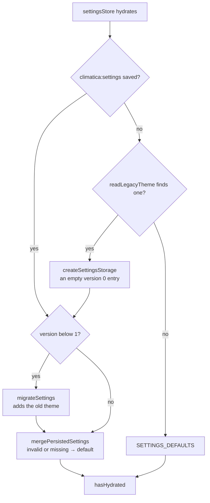

# Settings and persistence

What the app remembers about a reader, where, and the settings themselves. URL rules are in
[url-state.md](url-state.md); the language in [localization-i18n.md](localization-i18n.md).

## What is stored where

| Where                         | What                                                                            | Written by                                                             | Read by                                 |
| ----------------------------- | ------------------------------------------------------------------------------- | ---------------------------------------------------------------------- | --------------------------------------- |
| URL                           | filters and page view state                                                     | the URL hooks                                                          | every page; the source of truth         |
| `climatica:settings`          | every preference but the language, one object                                   | [`settingsStore`](../src/stores/settingsStore.ts)                      | the store; the inline theme script      |
| `climatica:lastSelectedCity`  | City Climate's and Compare Periods' city                                        | [`persistedLocationStores`](../src/stores/persistedLocationStores.ts)  | the pages, when the URL names no city   |
| `climatica:compareCityA`, `B` | Compare Cities' cities                                                          | `persistedLocationStores`                                              | Compare Cities, when the URL names none |
| `climatica:lastPageParams`    | each page's own params, last seen                                               | [`useLastPageParamsSync`](../src/hooks/url/useLastPageParamsSync.ts)   | navbar links, at click time             |
| `NEXT_LOCALE` cookie          | the language                                                                    | [`setLocale`](../src/libs/actions/setLocale.action.ts) (server action) | the server, every request               |
| memory                        | fetched data, the navigation intent, the inactive dataset's selection, UI state | —                                                                      | —                                       |

Keys are in [`localStorageKeys.constant.ts`](../src/constants/localStorageKeys.constant.ts); no
sessionStorage, no other cookie. Everything that decides what a page shows is in the URL, so a
shared link opens what its sender saw; localStorage only fills what a URL leaves out or caches.
The language is a cookie because the server renders in it.

## The settings store

One persisted Zustand store ([`settingsStore`](../src/stores/settingsStore.ts)); defaults in
`SETTINGS_DEFAULTS` ([`settings.constant.ts`](../src/constants/settings.constant.ts)):

| Setting              | Default | Effect                                                                                  |
| -------------------- | ------- | --------------------------------------------------------------------------------------- |
| `theme`              | system  | light, dark or the device's                                                             |
| `animationsEnabled`  | on      | every transition and animation                                                          |
| `updateFlashVariant` | glow    | how a card marks new data: border and glow, or border only                              |
| `autoApplyFilters`   | on      | the sidebar applies 200 ms after the last change; off: Apply ([filters.md](filters.md)) |
| `syncCity`           | on      | a city picked on one page opens on the others (`CITY_SLOT_RULES`)                       |
| `syncFilters`        | on      | navbar links carry the filters ([url-state.md](url-state.md#filters-across-pages))      |
| `autoScroll`         | off     | scroll to the results after a picked city's data shows                                  |
| `chartBarStyle`      | plain   | how a comparison overlay's bars tell entities apart ([charts.md](charts.md#bar-styles)) |

### Loading the saved settings

Every value is validated on load ([`settings.util.ts`](../src/utils/settings.util.ts)), so a new
setting needs no version bump. After hydration
[`useLegacyStorageCleanup`](../src/hooks/persisted/useLegacyStorageCleanup.ts) removes the old
keys (`LEGACY_STORAGE_KEYS`). Code that acts on a setting at load waits for `hasHydrated`.

## Theme

An inline script in the root layout's `<head>` (`THEME_INIT_SCRIPT`) sets the `dark` class
before the first paint, so there's no flash. Then [`ThemeRoot`](../src/components/ThemeRoot/ThemeRoot.tsx)
(`useThemeSync`) keeps it in step with the store and, for system, with `prefers-color-scheme`.

## Animations

Motion runs only while the setting is on and the device doesn't ask for reduced motion
([`useMotionPreference`](../src/hooks/ui/useMotionPreference.ts)).

- **CSS:** [`MotionRoot`](../src/components/MotionRoot/MotionRoot.tsx) sets `data-motion="off"` on
  `<html>`; one rule in [`animations.css`](../src/styles/animations.css) turns off every transition
  (another does so under `prefers-reduced-motion`), so a new transition is covered without code.
- **JS:** the update and arrival flashes, the card's crossfade and Recharts' animations check
  `isMotionEnabled` themselves.
- **Timing:** every duration and easing is in `MOTION`
  ([`motion.constant.ts`](../src/constants/motion.constant.ts)), exposed as `--motion-*`.

## Settings page

`/settings` ([`useSettingsPage`](../src/hooks/pages/useSettingsPage.ts)) has three groups:
Language, Appearance, Charts and filters. It writes the store directly, so changes apply at once.

- A setting that depends on another is nested under it (`SettingsDependentRows`) and disabled
  with a hint while that one is off (update highlight needs animations; both lock under reduced
  motion).
- The bar style is a radio group of cards
  ([`BarStylePicker`](../src/app/settings/_components/components/BarStylePicker.tsx)); each
  thumbnail ([`BarStylePreview`](../src/app/settings/_components/components/BarStylePreview.tsx))
  is drawn with the chart's own bar shape and layout, so it always matches the chart.
- The page has no filters. The language dropdown saves the cookie and re-renders in place.

## Adding a setting

1. Add the field to `TSettings` and its default to `SETTINGS_DEFAULTS`.
2. Save it in `getPersistedSettings`, validate it in `mergePersistedSettings`.
3. Add its row to the page (`BEHAVIOUR_SETTINGS` for a charts-and-filters switch).
4. Read it with `useSettingsStore`; wait for `hasHydrated` if it acts on load.
5. Texts in all 10 locales; tests in [`settingsStore.test.ts`](../tests/unit/stores/settingsStore.test.ts).
