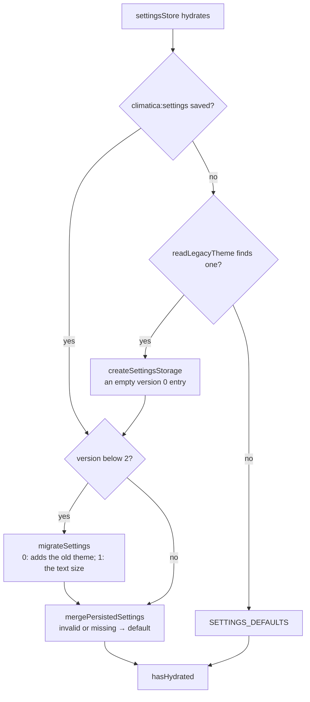

# Settings and persistence

What the app remembers about a reader, where, and the settings themselves. URL rules are in
[url-state.md](url-state.md); the language in [localization-i18n.md](localization-i18n.md).

## What is stored where

| Where                         | What                                                                            | Written by                                                             | Read by                                 |
| ----------------------------- | ------------------------------------------------------------------------------- | ---------------------------------------------------------------------- | --------------------------------------- |
| URL                           | filters and page view state                                                     | the URL hooks                                                          | every page; the source of truth         |
| `climatica:settings`          | every preference but the language, one object                                   | [`settingsStore`](../src/stores/settingsStore.ts)                      | the store; the inline head scripts      |
| `climatica:lastSelectedCity`  | City Climate's and Compare Periods' city                                        | [`persistedLocationStores`](../src/stores/persistedLocationStores.ts)  | the pages, when the URL names no city   |
| `climatica:compareCityA`, `B` | Compare Cities' cities                                                          | `persistedLocationStores`                                              | Compare Cities, when the URL names none |
| `climatica:lastPageParams`    | each page's own params, last seen                                               | [`useLastPageParamsSync`](../src/hooks/url/useLastPageParamsSync.ts)   | navbar links, at click time             |
| `climatica:analyticsConsent`  | the analytics choice, its consent version and time                              | [`analyticsConsentStore`](../src/stores/analyticsConsentStore.ts)      | GA's loader, the banner, Settings       |
| `NEXT_LOCALE` cookie          | the language                                                                    | [`setLocale`](../src/libs/actions/setLocale.action.ts) (server action) | the server, every request               |
| memory                        | fetched data, the navigation intent, the inactive dataset's selection, UI state | —                                                                      | —                                       |

Keys are in [`localStorageKeys.constant.ts`](../src/constants/localStorageKeys.constant.ts); no
sessionStorage, no other cookie. Everything that decides what a page shows is in the URL, so a
shared link opens what its sender saw; localStorage only fills what a URL leaves out or caches.
The language is a cookie because the server renders in it.

## The settings store

One persisted Zustand store ([`settingsStore`](../src/stores/settingsStore.ts)); defaults in
`SETTINGS_DEFAULTS` ([`settings.constant.ts`](../src/constants/settings.constant.ts)):

| Setting              | Default | Effect                                                                                  |
| -------------------- | ------- | --------------------------------------------------------------------------------------- |
| `theme`              | system  | light, dark or the device's                                                             |
| `textSize`           | default | all text and the on-screen charts at 87.5 to 125% ([styles.md](styles.md))              |
| `animationsEnabled`  | on      | every transition and animation                                                          |
| `updateFlashVariant` | glow    | how a card marks new data: border and glow, or border only                              |
| `autoApplyFilters`   | on      | the sidebar applies 200 ms after the last change; off: Apply ([filters.md](filters.md)) |
| `syncCity`           | on      | a city picked on one page opens on the others (`CITY_SLOT_RULES`)                       |
| `syncFilters`        | on      | navbar links carry the filters ([url-state.md](url-state.md#filters-across-pages))      |
| `autoScroll`         | off     | scroll to the results after a picked city's data shows                                  |
| `chartBarStyle`      | plain   | how a comparison overlay's bars tell entities apart ([charts.md](charts.md#bar-styles)) |

### Loading the saved settings

Every value is validated on load ([`settings.util.ts`](../src/utils/settings.util.ts)), so a new
setting needs no version bump. After hydration
[`useLegacyStorageCleanup`](../src/hooks/persisted/useLegacyStorageCleanup.ts) removes the old
keys (`LEGACY_STORAGE_KEYS`). Code that acts on a setting at load waits for `hasHydrated`.

## Theme

An inline script in the root layout's `<head>` (`THEME_INIT_SCRIPT`) sets the `dark` class
before the first paint, so there's no flash. Then [`ThemeRoot`](../src/components/ThemeRoot/ThemeRoot.tsx)
(`useThemeSync`) keeps it in step with the store and, for system, with `prefers-color-scheme`.

## Text size

`TEXT_SIZE_SCALES` (Smaller 0.875, Small 0.9375, Default 1, Large 1.125, Larger 1.25) sets `--text-scale` on `<html>`, which multiplies the
browser's own font size ([styles.md](styles.md#text-size)). Like the theme, an inline head script
(`TEXT_SIZE_INIT_SCRIPT`) applies the saved size before the first paint;
[`TextSizeRoot`](../src/components/TextSizeRoot/TextSizeRoot.tsx) (`useTextSizeSync`) keeps it in
step with the store.

On the Settings page it is a `StepSlider`; the row's description names the step. A drag moves only
the slider and applies on release (the native `change` event), so the page doesn't reflow under the
finger; each key step (arrows, Home, End) applies at once.

## Animations

Motion runs only while the setting is on and the device doesn't ask for reduced motion
([`useMotionPreference`](../src/hooks/ui/useMotionPreference.ts)).

- **CSS:** [`MotionRoot`](../src/components/MotionRoot/MotionRoot.tsx) sets `data-motion="off"` on
  `<html>`; one rule in [`animations.css`](../src/styles/animations.css) turns off every transition
  (another does so under `prefers-reduced-motion`), so a new transition is covered without code.
- **JS:** the update and arrival flashes, the card's crossfade and Recharts' animations check
  `isMotionEnabled` themselves.
- **Timing:** every duration and easing is in `MOTION`
  ([`motion.constant.ts`](../src/constants/motion.constant.ts)), exposed as `--motion-*`.

## Analytics consent

Only with `NEXT_PUBLIC_GA_ID` set ([operations.md](operations.md#google-analytics-id)); without
it there's no banner, no Settings row, no Cookie settings and no GA code.

- [`AnalyticsConsent`](../src/components/consent/AnalyticsConsent.tsx), mounted once in
  `AppLayout`, renders GA (`@next/third-parties`) only once accepted: before that no script and no
  request to Google. Our defaults are queued before GA's config: ads storage and personalisation
  denied, no Google signals, no automatic page view. One page view per pathname is ours, with
  the query and hash stripped ([operations.md](operations.md#google-analytics-id)); the rest is
  GA4's enhanced measurement, set in the property.
- Rejecting or withdrawing sets GA's opt-out flag (`ga-disable-<ID>`, a loaded gtag stops) and
  expires `_ga` / `_ga_*` on the host and every domain above it.
- The choice ([`useAnalyticsConsent`](../src/hooks/persisted/useAnalyticsConsent.ts)) is stored
  with `ANALYTICS_CONSENT.VERSION` and its time; a different version or one over 12 months old
  reads as none, and the banner asks again. Raise the version when what's collected changes.
- [`ConsentBanner`](../src/components/consent/ConsentBanner.tsx): a labelled region, not a dialog
  (no focus taken or trapped); fixed, so it shifts nothing; Accept and Reject alike. Below the
  bottom sheets (a sheet's buttons stay reachable); `<main>` gets its height as end padding
  (`--consent-banner-height`), so nothing stays under it.
- Changed later in Settings (Privacy → Analytics), or with Cookie settings (the Info footer and
  the Privacy section), which reopens the banner (`consentBannerStore`).

## Settings page

`/settings` ([`useSettingsPage`](../src/hooks/pages/useSettingsPage.ts)) is one `Card`, centred and at
most 40rem wide: Language, Appearance, Charts and filters, Privacy (with analytics only), each an h2 (`SettingsGroup`), a hairline
between sections. It writes the store directly, so changes apply at once. Flat: no shadows. Below
`sm`: 1rem card padding, smaller headings, tighter rows.

- Every row is a `SettingsRow`: label and description left, control right; one min height and
  padding, a hairline (`--color-divider`) between rows. A switch labels and describes itself.
- Placement (`ESettingsControlPlacement`), by the kind of control:
  - FIT (default; wide controls: segmented, slider): the control goes under the label at full
    width when the two don't fit side by side at their natural widths (flex-wrap, no breakpoints;
    the description doesn't widen the label). Below `sm` the text block is `display: contents`:
    label and control share the first line, the description runs under both across the row —
    under the control once it has wrapped. That line is the label's line height; the control is
    centred on it and overflows it (its 44px target is `touch-target`'s), so the description sits
    0.25rem under the label. Whether it wrapped is measured (`useIsWrapped`): CSS can't tell.
  - BESIDE (narrow: the language dropdown) and switches: label and description stacked on the
    left, the control right, centred on them.
  - BELOW: always under them (the bar style cards).
- Segmented controls use `ESegmentedSize.COMPACT` (a ~2.25rem pill below `sm`, 44px target).
- Segmented controls always show their icons and labels, in equal segments; one that doesn't fit
  beside its label wraps under it, and one whose labels don't fit inline becomes a vertical list
  (styles.md).
- Each control's `aria-describedby` is its row's description. Descriptions change with state: the
  text size's step name, the reduced-motion notice for Animations, the turn-on-animations hint for
  Update highlight (not under reduced motion: it's not the reader's to change).
- The bar style is a radio group of cards
  ([`BarStylePicker`](../src/app/settings/_components/components/BarStylePicker.tsx)); each
  thumbnail ([`BarStylePreview`](../src/app/settings/_components/components/BarStylePreview.tsx))
  is drawn with the chart's own bar shape and layout, so it always matches the chart. From `sm`
  the selected thumbnail is ringed; below it a radio indicator sits under each name.
- The page has no filters. The language dropdown saves the cookie and re-renders in place.

## Adding a setting

1. Add the field to `TSettings` and its default to `SETTINGS_DEFAULTS`.
2. Save it in `getPersistedSettings`, validate it in `mergePersistedSettings`.
3. Add its row to the page (`BEHAVIOUR_SETTINGS` for a charts-and-filters switch) with a
   description.
4. Read it with `useSettingsStore`; wait for `hasHydrated` if it acts on load.
5. Texts in all 10 locales; tests in [`settingsStore.test.ts`](../tests/unit/stores/settingsStore.test.ts).
