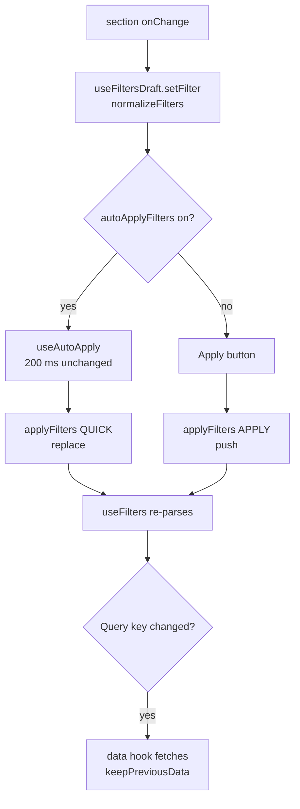
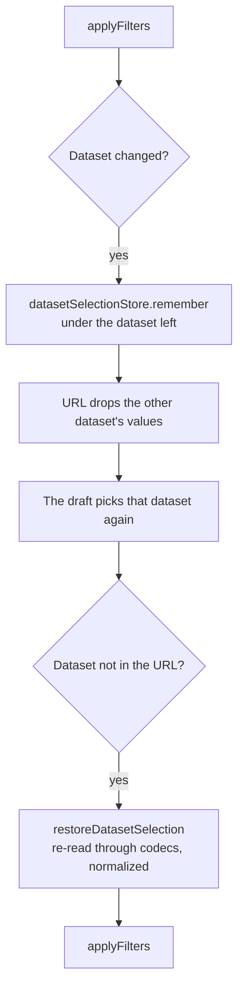

# URL state

The URL is the single source of truth for everything a page shows: filters (dataset, period,
variables, resolution, months, Compare Periods' periods and years) and page view state (city,
chart mode, layout, shading, expanded panel, pair, shown years, Compare Periods' order and
markers, the heat map's selection). A shared link opens exactly what was on screen.

## Who writes the URL

Router calls happen only in these hooks:

| Hook                                                                     | Owns                                   | Writes                                                                                       |
| ------------------------------------------------------------------------ | -------------------------------------- | -------------------------------------------------------------------------------------------- |
| [`useFilterNavigation`](../src/hooks/filters/useFilterNavigation.ts)     | filter params                          | `applyFilters(next, mode)`: replace (`QUICK`) or push (`APPLY`); page params kept            |
| [`useUrlStateSync`](../src/hooks/ui/useUrlStateSync.ts)                  | a page's own params, by its URL schema | replace when page state drifts; `pushUrlState` for explicit actions; filter params untouched |
| [`useChartModeUrl`](../src/hooks/url/useChartModeUrl.ts)                 | `chart`                                | replace                                                                                      |
| [`useNavbarNavigation`](../src/hooks/url/useNavbarNavigation.ts)         | navbar, logo and settings links        | push to another page                                                                         |
| [`useCanonicalFilterUrl`](../src/hooks/filters/useCanonicalFilterUrl.ts) | canonical filter params                | replace once when the URL isn't canonical                                                    |
| [`useLocaleSwitch`](../src/hooks/url/useLocaleSwitch.ts)                 | the `NEXT_LOCALE` cookie               | saves the cookie, then `router.refresh()`                                                    |

Reading: [`useFilters`](../src/hooks/filters/useFilters.ts) parses the filters; each page's schema
parses its own params. Components outside a page that need a page param (the sidebar reading
Compare Periods' `order` and `markers`) parse it read-only.

## How a page keeps its state in the URL

`useUrlStateSync` compares the page params in the URL with those its state would write
([`decideUrlSyncAction`](../src/utils/urlParams.util.ts)):

- **external** (load, Back/Forward, an edited address): the page restores its state (`onRestore`);
- **stateChange**: the URL is replaced with the new params;
- **ownWrite**: the URL caught up with the hook's own write; nothing to do.

Nothing is read or written before the first client render (the persisted cities load then).
Fields the URL carries win; the rest keep their persisted value or default.

Writes are scheduled and re-checked when they run
([`canWriteUrlState`](../src/utils/urlStateGuard.util.ts)): a write is dropped if the page is no
longer current, a link navigation is on its way, or the URL changed since. Otherwise a late
`replace` on the page being left would cancel the navigation.
[`NavigationIntentTracker`](../src/components/NavigationIntentTracker/NavigationIntentTracker.tsx)
records a link click's target before the router acts.

## Canonical filter params

[`getCanonicalFilterUrlParams`](../src/utils/filtersUrl.util.ts) drops defaults and invalid
values, rewrites legacy params, removes values the dataset doesn't use, and normalizes
([`normalizeFilters`](../src/utils/filters.util.ts)). `useCanonicalFilterUrl` replaces the URL with
it once; the canonical form is a fixed point, so this never loops. Filter encodings are codecs in
[`filterCodecs.util.ts`](../src/utils/filterCodecs.util.ts); page params are `TUrlField`s in
[`urlFields.util.ts`](../src/utils/urlFields.util.ts), which leave defaults out.

**Legacy params** (read, never written): `year1` + `year2` → `periods`, `wlLayout` → `layout`,
`wlYears` → `pair`, `chart=wl` → Walter-Lieth. Names are in
[`SIDEBAR_PARAMS`](../src/constants/sidebar.constant.ts).

## The last-page-params cache

Navbar links bring back each page's own params (e.g. Compare Periods' years and layout) after a
trip elsewhere.

- **Store:** [`lastPageParamsStore`](../src/stores/lastPageParamsStore.ts) (`climatica:lastPageParams`),
  a cache, never a source of truth. Pages never read it.
- **Single writer:** [`useLastPageParamsSync`](../src/hooks/url/useLastPageParamsSync.ts) records a
  page's URL state minus the city, its page-placed filters and its shared filters
  ([`extractPageParams`](../src/utils/pageParams.util.ts)).
- **Single reader:** `useNavbarNavigation`, at click time. The rendered `href` carries only the
  shared filters, so server and client render the same link and a new tab opens a plain URL. A
  plain click builds the target with [`buildNavbarHref`](../src/utils/pageParams.util.ts),
  re-validated through the page's URL fields
  ([`REMEMBERED_PAGE_PARAMS`](../src/constants/pageParams.constant.ts)).

## Filters across pages

The `syncFilters` setting ([settings.md](settings.md)) picks whose shared filters a page gets:

|                                    | On (default)                         | Off                                                       |
| ---------------------------------- | ------------------------------------ | --------------------------------------------------------- |
| Navbar click                       | the current page's                   | the target's remembered ones (the current if it has none) |
| Dataset switch                     | restores the last selection anywhere | restores this page's last selection                       |
| Scope (`getDatasetSelectionScope`) | `allPages`                           | the page's route                                          |

A URL with explicit filters always shows them. The rendered `href` always carries the current
filters (the setting is client-only, read at click time). The city has its own setting
(`syncCity`); page state is per page in both modes.

## UrlSync

App-wide URL upkeep — canonical params, the last-page-params writer, the legacy storage cleanup —
runs once in [`useFilterUrlSync`](../src/hooks/filters/useFilterUrlSync.ts). It reads
`useSearchParams`, so it needs a host inside a Suspense boundary: [`UrlSync`](../src/layouts/UrlSync.tsx)
in `AppLayout`.

## Why sheets close before navigating

An open bottom sheet adds a same-URL history entry, so system Back closes it
([`useSheetHistory`](../src/hooks/ui/useSheetHistory.ts)). Next's router calls rewrite
`history.state`; one made while a sheet is open would orphan that entry, leaving a Back press that
does nothing. So every write from the filters sheet goes through
[`useFiltersSheet`](../src/hooks/filters/useFiltersSheet.ts): `await closeSheet()` first, then the
router call.

## Flows

### Page load from a shared link

1. **Locale:** [`src/proxy.ts`](../src/proxy.ts) redirects an old prefixed path (`/es/…`) without
   the prefix (308); the locale comes from the cookie, then `Accept-Language`
   ([localization-i18n.md](localization-i18n.md)).
2. **Server render:** the root layout sets the theme before first paint and loads messages and
   providers; `page.tsx` builds metadata from the search params and renders the container in
   `Suspense`. Data hooks don't fetch on the server: the page renders its loading state.
3. **Hydration:** `UrlSync` replaces a non-canonical URL once and records the page's params.
4. **Restore:** after the first client render, `useUrlStateSync` sees params it didn't write and
   calls `onRestore`. If the restored state writes params the link lacked (the persisted city),
   the next pass replaces them in.
5. **Data:** queries run with keys from the city and filters ([Data](#data)).

### A filter change (sidebar)

`applyFilters` writes canonical filter params and keeps page params. The draft follows the applied
filters, and neither `useCanonicalFilterUrl` nor `useUrlStateSync` writes again. A change outside
the keys (variables, months, the climate period) is applied to the data already loaded.

### A filter change (mobile sheet)

1. A chip opens one filter's sheet, all filters, or why a chip is disabled
   (`useFiltersSheet`); the sheet pushes its history entry and resets its draft.
2. In one filter's sheet a single-choice filter applies on pick; others wait for Apply. The
   all-filters sheet edits the draft until Apply (Reset: defaults).
3. Apply: `await closeSheet()`, then `applyFilters` — `QUICK` from one filter's sheet, `APPLY` from
   all filters. Closing without Apply drops the draft.

### A dataset switch

What's remembered is the other dataset's periods or years and the Climate-only values a switch
narrows (`srad`, `wind`, `vapr`, `30s`), per scope ([filters across pages](#filters-across-pages)).
Values the reader changed since are kept. Memory only: a reload keeps just the URL's dataset, and
a URL's own selection is never replaced.

### Back / Forward

Back pops the entry; `useFilters` re-parses and the draft follows; `useUrlStateSync` restores page
state only if page params differ. A write scheduled just before the popstate is dropped. Previous
query keys are still cached, so their data shows at once. With a sheet open, Back first closes it.

### Navbar navigation

1. Each link's `href` is the route plus the current shared filters.
2. On click, the intent is recorded so late writes on the old page are dropped.
3. A plain left click builds the target: remembered page params and page-placed filters, plus the
   shared filters, which win; validated together (years remembered under Weather drop under
   Climate).
4. `router.push`; the new page follows the load flow from step 3 and records its params.

## Data

Data hooks ([`src/hooks/data/`](../src/hooks/data)) build TanStack Query keys from what decides
the request:

| Hook                                 | Query key                                                     |
| ------------------------------------ | ------------------------------------------------------------- |
| `useGetClimateData`                  | `["climate", lat, lng, gridSize, "climate" \| weatherYear]`   |
| `useGetCompareData`                  | `["compare", latA, lngA, latB, lngB, gridSize, …]`            |
| `useGetComparePeriods`               | `["compare-periods", lat, lng, gridSize, "climate" \| years]` |
| `useGetMultiPeriodData`              | one per year: `["compare-period", lat, lng, gridSize, year]`  |
| `useGetHeatmapData`                  | `["heatmap", area, gridSize, variable, dataset]`              |
| `useGetRegionalProfile`              | `["regional-profile", area, gridSize, dataset]`               |
| `useGetAltitude`, `useGetCellBounds` | `["altitude" / "cellBounds", lat, lng, gridSize]`             |

- A filter in a key refetches (`keepPreviousData` keeps the old data meanwhile).
- Climate normals for a point come in one request for every period, so the period is applied to
  loaded data; point requests always ask for the same variables, so variables and months only
  change what's drawn.
- WorldClim values never change, so data hooks use `staleTime: Infinity`; Back within the cache
  time (TanStack Query v4's default 5 minutes) re-renders with no request. The server adds a Redis
  cache ([backend.md](backend.md)).

## Parameter reference

A param at its default is left out.

| Param                            | Owner   | Pages                                            | Default                                      | Allowed values                                       | Legacy            |
| -------------------------------- | ------- | ------------------------------------------------ | -------------------------------------------- | ---------------------------------------------------- | ----------------- |
| `dataset`                        | filters | all                                              | `climate`                                    | `climate`, `weather`                                 |                   |
| `period`                         | filters | City Climate, Compare Cities, Heat map (Climate) | `c1970-2000`                                 | a climate period (`CLIMATE_PERIODS`)                 |                   |
| `year`                           | filters | City Climate, Compare Cities, Heat map (Weather) | `WEATHER_MAX_YEAR`                           | `WEATHER_MIN_YEAR`–`WEATHER_MAX_YEAR`                |                   |
| `var`                            | filters | all                                              | `tmax,tmin,prec`                             | also `srad`, `wind`, `vapr` (Climate 1970–2000 only) |                   |
| `grid`                           | filters | all                                              | `2.5m`                                       | `10m`, `5m`, `2.5m`, `30s` (Climate 1970–2000 only)  |                   |
| `months`                         | filters | all (disabled on the heat map)                   | `all`                                        | `all` or 1–12, comma list                            |                   |
| `period1`, `period2`             | filters | Compare Periods (Climate)                        | `c1970-2000`, `c1991-2020`                   | climate periods, never equal                         |                   |
| `periods`                        | filters | Compare Periods (Weather)                        | `2021,1967`                                  | 2–5 weather years, in the order added                | `year1` + `year2` |
| `city`, `lat`, `lng`             | page    | City Climate, Compare Periods                    | the persisted city                           | name; coordinates to 4 decimals                      |                   |
| `cityA`…`lngB`                   | page    | Compare Cities                                   | the persisted cities                         | as above                                             |                   |
| `chart`                          | page    | City Climate, Compare Cities, Compare Periods    | Walter-Lieth                                 | `standard`                                           | `chart=wl`        |
| `layout`                         | page    | Compare Cities, Compare Periods                  | `split`                                      | `overlay`                                            | `wlLayout`        |
| `wlShading`                      | page    | Compare Cities, Compare Periods                  | `a`                                          | `b`, `none`                                          |                   |
| `expanded`                       | page    | Compare Cities, Compare Periods                  | both panels                                  | `a`, `b`                                             |                   |
| `pair`                           | page    | Compare Periods (Weather, side by side)          | the first two years                          | two years, `y1,y2`                                   | `wlYears`         |
| `shownYears`                     | page    | Compare Periods (Weather, overlay)               | Walter-Lieth: the pair; standard: every year | years, comma list                                    |                   |
| `order`                          | page    | Compare Periods                                  | oldest first                                 | `desc`                                               |                   |
| `markers`                        | page    | Compare Periods (Weather)                        | each year its place in `periods`             | `year:slot` pairs, unique                            |                   |
| `north`, `south`, `west`, `east` | page    | Heat map                                         | no selection                                 | a drawn box                                          |                   |
| `polygon`                        | page    | Heat map                                         | no selection                                 | a drawn polygon (WKT)                                |                   |

The locale isn't in the URL: it's the `NEXT_LOCALE` cookie.

## Push or replace

| Action                                                                         | History         | Back afterwards              |
| ------------------------------------------------------------------------------ | --------------- | ---------------------------- |
| Sidebar Apply; all-filters sheet Apply                                         | push            | the filters before the Apply |
| Sidebar auto-apply; one filter's sheet; Compare Periods' on-page selectors     | replace         | skips the change             |
| Canonicalising a URL                                                           | replace         | —                            |
| Picking a city (search, location, a map click)                                 | push            | the previous city            |
| The city name resolved after a map click                                       | replace         | the city before the click    |
| Drawing or clearing a heat map selection                                       | push            | the previous selection       |
| Layout, shading, expanded panel, pair, shown years, order, markers, chart type | replace         | skips the change             |
| Navbar, logo or settings link                                                  | push            | the previous page            |
| Language switch                                                                | none            | —                            |
| Opening a filters sheet                                                        | push (same URL) | closes the sheet             |

"Skips the change": Back goes to the entry before the last push.
